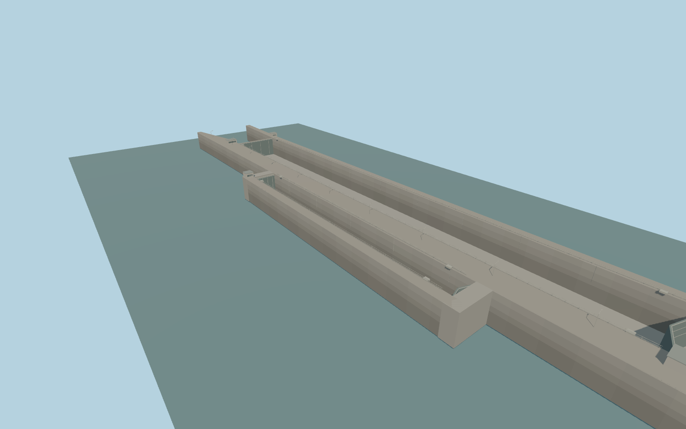

# Iron Gate II Romanian navigation locks

Two adjoining Romanian lock chambers with distinct widths, a long tapered shared divider, concrete coping, steel end gates, small control structures and guide-wall lighting.

The Romanian island locks have their own World Explorer preview placement and stream with four detail levels. [Placement review](QA-REVIEW.md) · [Main Iron Gate II crossing](../iron_gate_ii_hydroelectric_power_station/README.md)

Rebuild with node content/worldgen/source/places/sx/sxb/iron_gate_ii_romanian_locks/models/generate-romanian-locks.mjs. The importer and runtime LOD generator select --ids=iron_gate_ii_romanian_locks.
