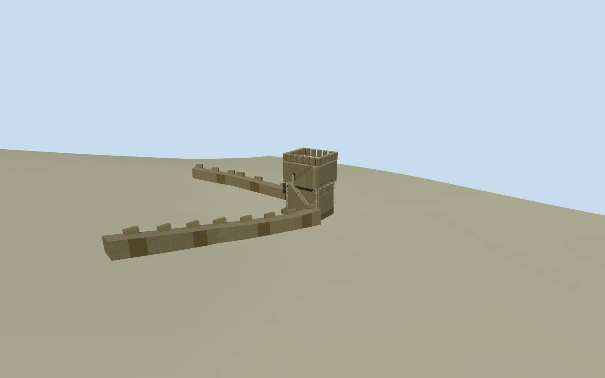

# Baldwin’s Tower at Tsarevets

Reconstructed stone tower of Tsarevets Fortress with a cantilevered crenellated crown, exposed stairs and mapped curtain walls immediately alongside.

Authoring state: **review-in-qa.json**. Current completion evidence is in [qa.json](qa.json) and the [completion ledger](../../../../qualla-structures/batches/qualla-004.PROGRESS.md).

- [Tsarevets Fortress](https://qualla.com/tsarevets-fortress/)

The tower and immediately adjoining curtain are modeled. The northern and western castle circuit, skyline church, and other foundations belong to the wider site.

The standing profile follows the surviving photograph and mapped footprint. Precise stonework, door and stair details, wall top grades and close cliff footing are approximations.

Build: `node content/worldgen/source/places/sx/sxd/baldwins_tower_tsarevets/models/generate-baldwins-tower-tsarevets.mjs`. Add `--check` to verify exact regeneration. 2892 triangles; 4 materials; no embedded photographs.
