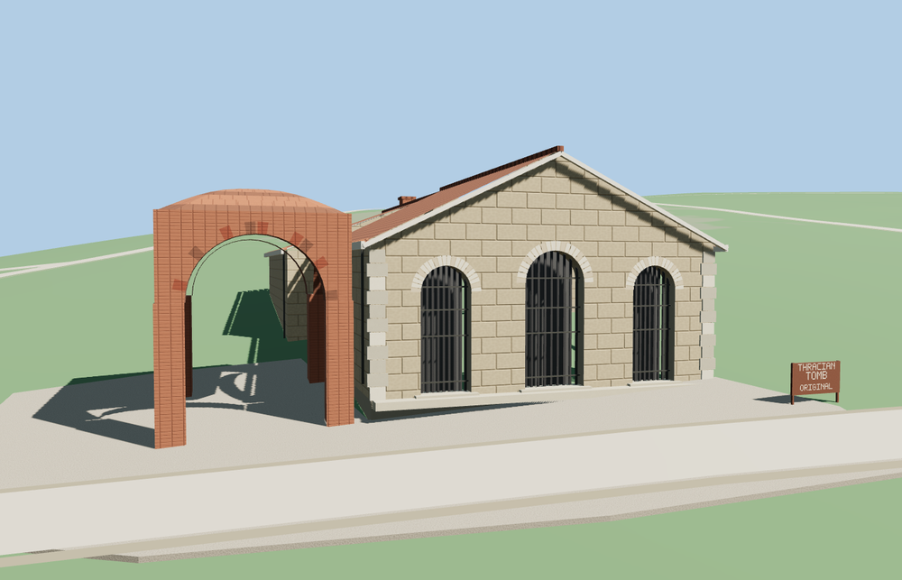

# Thracian Tomb of Kazanlak

The original Thracian tomb has a tiled stone protective pavilion with three recessed iron-grilled arches, a freestanding four-sided brick vault and a stone forecourt. The editable master includes the northern corbelled burial chamber, a narrow dromos and a stone antechamber. Its concentric friezes use original colored geometry.

The 10,026-triangle source master rebuilds from the editable geometry. The four runtime levels have 564, 1,250, 3,472, 4,762 triangles. Skyline and district total 151,312 bytes. All six GLBs validate with zero errors, warnings or embedded images.

The viewer replaces the original pavilion footprint and preserves the independent mapped building, 51 transportation records, terrain, water and land cover. Every level preserves the two roof ridges, three recessed facade arches, open brick vault and stone forecourt. A failed load restores the pavilion footprint. Eviction releases the model geometry.

Inspected 25 geographic and 13 standalone views, including the corbelled chamber and its passage. The mapped pavilion footprint and its southern approach establish geographic fit and heading. The open brick vault, roof heights and paving perimeter are photo estimates. Standard Terrarium terrain gives the pavilion a partly banked rear wall. Foundation bottoms follow the sampled grade. Nearby park paths and land cover remain in place. The source master includes the below-grade burial chamber, dromos and antechamber from the published section image. The concentric bands and figures are an original simplified reconstruction. Chamber depth within the protective building is estimated. The exterior LODs omit below-grade geometry, and the native site remains closed. The visitor replica stays a separate mapped point. The model sign reproduces the English wording. Physical-device timings remain unmeasured.

Run `node packages/worldgen/scripts/generate-thracian-tomb-of-kazanlak.mjs --check --ids=thracian_tomb_of_kazanlak` to confirm the source rebuild.
