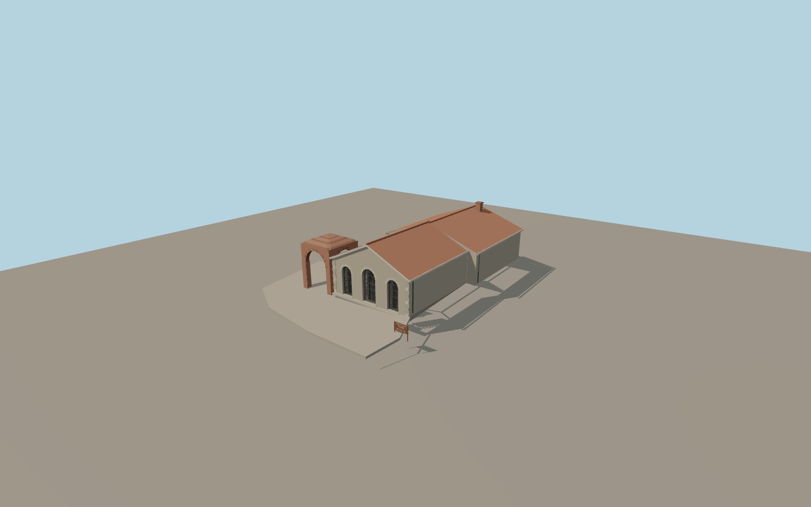

# Thracian Tomb of Kazanlak

The original Thracian tomb has a tiled stone protective pavilion with three recessed iron-grilled arches, a freestanding four-sided brick vault and a stone forecourt. The editable master includes the northern corbelled burial chamber, a narrow dromos and a stone antechamber. Its concentric friezes use original colored geometry.

Run `node packages/worldgen/scripts/generate-thracian-tomb-of-kazanlak.mjs` to rebuild the source master. Append `--check` to compare the exact bytes. Use `--ids=thracian_tomb_of_kazanlak` for targeted import, LOD generation and placement.

The mapped pavilion footprint and its southern approach establish geographic fit and heading. The open brick vault, roof heights and paving perimeter are photo estimates.

Standard Terrarium terrain gives the pavilion a partly banked rear wall. Foundation bottoms follow the sampled grade. Nearby park paths and land cover remain in place.

The source master includes the below-grade burial chamber, dromos and antechamber from the published section image. The concentric bands and figures are an original simplified reconstruction. Chamber depth within the protective building is estimated. The exterior LODs omit below-grade geometry, and the native site remains closed. The visitor replica stays a separate mapped point.

Original geometry follows the repository license. Map data is © OpenStreetMap contributors under ODbL-1.0 via Protomaps. Terrain samples are described in terrain-grid.json. Ordinary pictures stay local and are not redistributed or used as textures. Current acceptance is recorded in qa.json.
