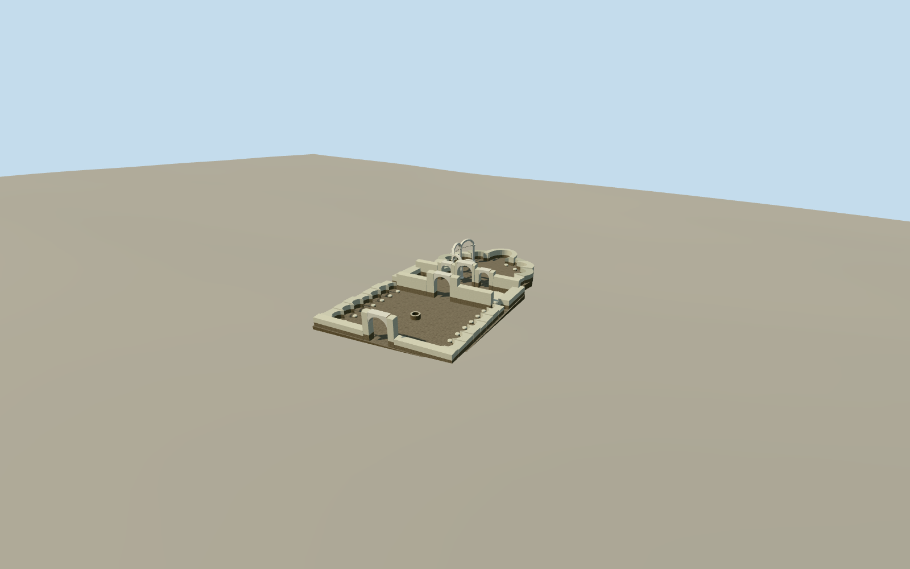

# Round Church, Preslav

The roofless Round Church at Preslav, with an open well court, surviving arches and white-capped scalloped sanctuary.

Authoring state: **review-in-qa.json**. Current completion evidence is in [qa.json](qa.json) and the [completion ledger](../../../../qualla-structures/batches/qualla-003.PROGRESS.md).

- [Round Church, Preslav](https://qualla.com/round-church-preslav/)

The model depicts the roofless archaeological site and restoration visible in the 2009–10 photographs. Individual broken courses, stucco edges, column repairs and exposed details are simplified.

The two mapped outlines and the 10.50 m naos dimension control the plan. The spacing and height of the surviving niches, portals and partial arcade are estimated from ground-level photographs.

The original source field remains unchanged. Floors and lower retaining faces follow approximate grades. The placement opens ground only inside the mapped ruin where the modeled floor covers it, so flat viewer terrain does not obscure the descending court and naos.

Build: `node content/worldgen/source/places/sx/sxe/round_church_preslav/models/generate-round-church-preslav.mjs`. Add `--check` to verify exact regeneration. 5810 triangles; 5 materials; no embedded photographs.
