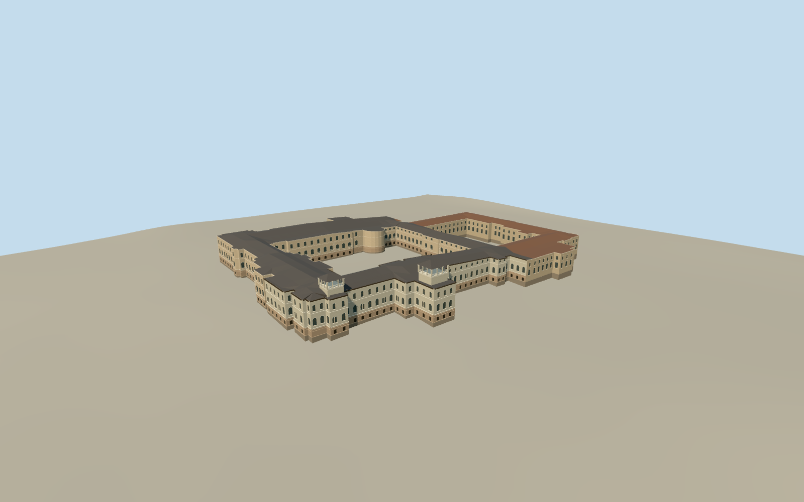

# Cotroceni Palace

Rusticated Venetian Classical royal residence, pale Neo-Romanian northern additions and the presidential wing, with two open courts.

Authoring state: **review-in-qa.json**. Current completion evidence is in [qa.json](qa.json) and the [completion ledger](../../../../qualla-structures/batches/qualla-003.PROGRESS.md).

- [Cotroceni Palace](https://qualla.com/cotroceni-palace/)

The model covers the connected palace exterior. The separately mapped Cotroceni church, grounds, park furniture and interiors are outside the palace model.

The cleared April 2018 photographs control the rusticated garden frontage, pale rounded bay, dark eaves and nearby window forms. Locations and dimensions of individual projections, roof pitches, rear elevations and hidden bay counts are estimates.

The original palace multipolygon retains both open courtyards. The 384 m independent terrain field and original Terrarium tiles remain unchanged. Site floor and threshold elevations are approximate.

Build: `node content/worldgen/source/places/sx/sxf/cotroceni_palace/models/generate-cotroceni-palace.mjs`. Add `--check` to verify exact regeneration. 42877 triangles; 6 materials; no embedded photographs.
