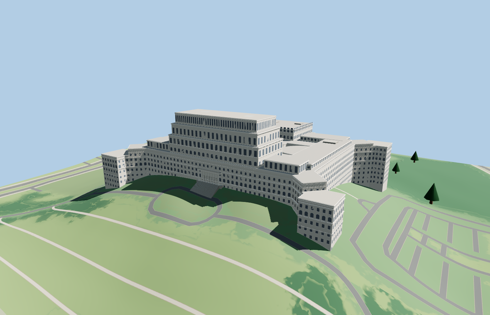

# Palace of the Parliament

The neoclassical palace presents a stepped central crown, symmetrical east ranges, lower projecting corner pavilions, the columned east balcony and west loggia, and two mapped open courts with distinct plans.

The 37,230-triangle source rebuilds byte for byte. Skyline, district, street and close-up use 908, 3,976, 15,732, 36,410 triangles. Skyline and district total 379,040 bytes. Six GLBs validated and 36 current views were inspected.

All four tiers pass the roof, two court floor, stair, portico and wall-contact probes. The viewer retains 14 independent building records and 137 transportation records. Failed loading restores the mapped palace footprint.

The outline and court voids follow the map. Above-ground block heights and stone ornament are reconstructed from exterior photographs, with an 84 m overall building height. The entrance staircase and court floors fit the standard terrain grid. Their exact levels and the interiors are outside this exterior reconstruction.

Rebuild with `node packages/worldgen/scripts/generate-palace-of-the-parliament.mjs`. Append `--check` to compare exact bytes. Use `--ids=palace_of_the_parliament` for targeted import, LOD, placement and readiness.
