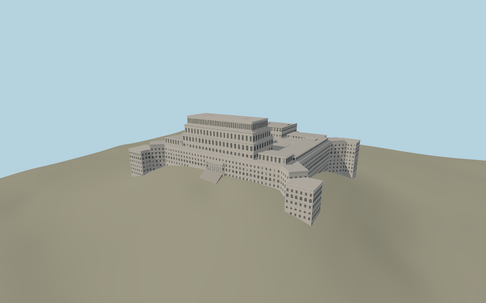

# Palace of the Parliament

The neoclassical palace presents a stepped central crown, symmetrical east ranges, lower projecting corner pavilions, the columned east balcony and west loggia, and two mapped open courts with distinct plans.

Run `node packages/worldgen/scripts/generate-palace-of-the-parliament.mjs` to rebuild the source master. Append `--check` to compare the exact bytes. Use `--ids=palace_of_the_parliament` for targeted import, LOD generation and placement.

The outline and court voids follow the map. Above-ground block heights and stone ornament are reconstructed from exterior photographs, with an 84 m overall building height.

The entrance staircase and court floors fit the standard terrain grid. Their exact levels and the interiors are outside this exterior reconstruction.

Original geometry follows the repository license. Map data is © OpenStreetMap contributors under ODbL-1.0 via Protomaps. Terrain samples are described in terrain-grid.json. Ordinary pictures stay local and are not redistributed or used as textures. Current acceptance is recorded in qa.json.
