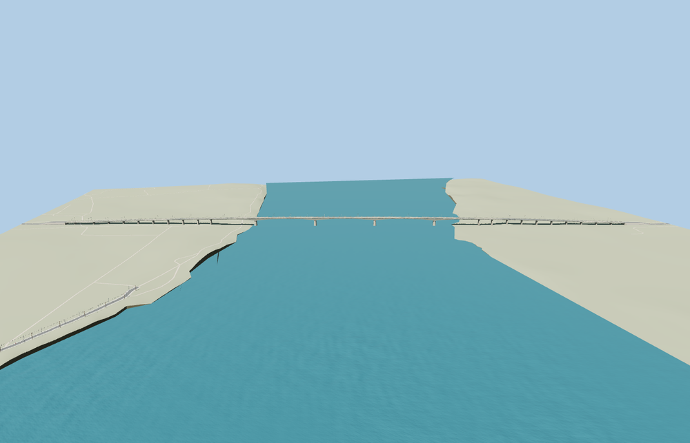

# Giurgeni – Vadu Oii Bridge

**Viewer readiness passed for the current Route91 crossing.**

Complete Giurgeni – Vadu Oii crossing: five haunched main river spans on four battered cutwater piers, long graded smaller-pier approaches, full four-lane roadway, concrete verge walks, W guardrails and shared expanded-metal outer fencing, paired curved two-height streetlight arms and distinct bank abutments. The full1499.943m mapped envelope controls placement; the720m river core is not substituted for the whole crossing.

Source37,280 triangles; skyline/district/street/close-up964 /3,120 /14,788 /33,120. Initial skyline plus district310,168 bytes; close-up2,574,260 bytes. Three existing shared graphs, four merged material bindings, metric UVs and zero embedded images. Six clean GLBs and34 inspected current images:10 portable plus24 native. Seventeen native context frames cover silhouette, three distances, noon/late lights, shadowless reduced-resolution Economy/High and four LOD transitions. Portable fallback materials show the whole source; actual alpha-tested mesh fencing is checked in the native shared-material view.

Retained1499.943m by17.149m envelope controls the full model; reported1464m length is kept as a separate scope measure. Actual native18 width-distributed road-join and14 approach probes pass on all four tiers. Both independent farm tracks remain unchanged, unprofiled and unobstructed. Six lower-route probes per tier give minimum sampled headroom4.819m across LODs and5.922m close-up. The five original water features include four line ribbons. Terrain and river geometry stay unchanged. All four tiers unload their model/support geometry; failed loads restore original inputs.

Ordinary-picture exterior approximation, not a surveyed engineering model. The river panorama and road photograph control the five-span haunched form, broad four-lane deck, open metal fencing and curved paired lamps. One unrelated stock picture showing a railway/truss crossing is excluded. The retained1499.943m envelope includes approach viaducts; reported1464m length is a separate scope measure. Concealed structure, support spacing, haunch depths, profile elevations, bearings and below-ground foundations are photo/map-guided approximations. No copied mesh, private photo texture, vehicles or readable signs. Native terrain is coarse; physical-device timing remains unmeasured. Native water uses the original standard terrain and actual polygon/river-ribbon renderer; no favorable flat water plane or terrain flattening is authored. The two mapped farm tracks are retained unchanged and receive no authored approach profiles. Six width-distributed track probes pass at every LOD with no horizontal obstruction: minimum sampled headroom4.819m across all tiers and5.922m close-up. These are visualization fit checks, not engineering clearance certification. Native automatic fallback and coarse terrain remain unchanged when the model is absent. Native default-width approach roads are preserved; the end verge walks are not claimed to continue into mapped sidewalks.

Rebuild: `node packages/worldgen/scripts/generate-giurgeni-vadu-oii-bridge.mjs` (append `--check` for exact bytes). Target import/LOD/placement/readiness with `--ids=giurgeni_vadu_oii_bridge`. No engine CI, audit, Git mutation or upload in this pass.
