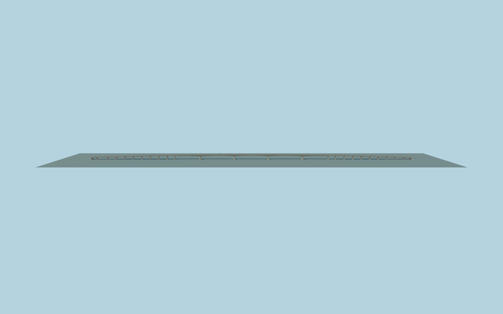

# Giurgeni – Vadu Oii Bridge

Complete Giurgeni – Vadu Oii crossing: five haunched main river spans on four battered cutwater piers, long graded smaller-pier approaches, full four-lane roadway, concrete verge walks, W guardrails and shared expanded-metal outer fencing, paired curved two-height streetlight arms and distinct bank abutments. The full1499.943m mapped envelope controls placement; the720m river core is not substituted for the whole crossing.

Rebuild: `node packages/worldgen/scripts/generate-giurgeni-vadu-oii-bridge.mjs`;append `--check` for exact source bytes. Select import/LOD/placement with `--ids=giurgeni_vadu_oii_bridge`. Detailed source and four browser tiers are separate ignored GLB outputs.

Ordinary-picture exterior approximation, not a surveyed engineering model. The river panorama and road photograph control the five-span haunched form, broad four-lane deck, open metal fencing and curved paired lamps. One unrelated stock picture showing a railway/truss crossing is excluded.

The retained1499.943m envelope includes approach viaducts; reported1464m length is a separate scope measure. Concealed structure, support spacing, haunch depths, profile elevations, bearings and below-ground foundations are photo/map-guided approximations. No copied mesh, private photo texture, vehicles or readable signs. Native terrain is coarse; physical-device timing remains unmeasured.

Original geometry:repository license. Map:© OpenStreetMap contributors,ODbL-1.0;Protomaps. Standard terrain:terrain-grid.json. Ordinary pictures stay local and are not redistributed or used as textures. Current acceptance:qa.json.
