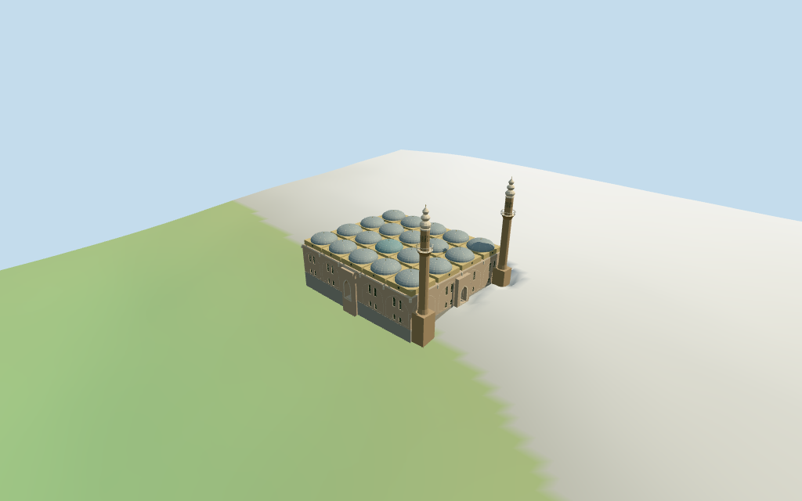

# Bursa Grand Mosque

Individual Bursa Grand Mosque exterior: retained rectangular hall,warm varied stone masonry,paired round-headed upper screen windows,small pointed lower niches/doors,broad blind wall arches,cornice brackets,projecting north and west portals,twenty low gray roof domes on raised ochre shoulders including one opaque glazed abstraction,and two slender warm-stone minarets with open balconies and pale double-bulb caps. Public fountains,bazaar,adjacent buildings,trees,fences,traffic,inscriptions,exact ornament,furnished interiors and engineering are excluded.

## Evidence and reconstruction

Published dimensions and reconstructed details are separated in spec.json. Primary references:

- [Reference](https://commons.wikimedia.org/wiki/File:Ulu_Camii_-_facades.jpg)
- [Reference](https://commons.wikimedia.org/wiki/File:Bursa_Ulucami.jpg)

Five existing shared256² raw/coursed/weathered limestone,standing-seam metal and bronze graphs;six merged roles include local opaque glazing. Metric UVs and linear tints,no embedded images or unique atlas. Original coarse bands,brackets,grids and ribs;no historic artwork or inscriptions are copied.

## Model and axes

26,642 triangles; 79,926 vertices; 6 material groups; 3,200,876 bytes. Native bounds: -41.224, -7.622, -32.240 to 35.776, 50.169, 30.889. Source hash: `sha256:f3169eb5e787a6b56824920d2ce3849d073d12d3ff43dabcee128a6aa112ad25`.

{"x":"eastern hall edge","y":"up","z":"southern hall edge"}

Standard Protomaps20261014 and Mapzen/USGS viewer extractN0483;datum 231.58724915930597 m. 1106 occupied samples range -7.000136064309828 to 5.558328570713115 m. Floor 0.16937117917186129 m is the median of 133 hall/pad edge samples plus0.25 m. Footings follow sampled grade;the review fixture seats the hall,both pads and two portals with a3 m margin. Public fountains and neighboring buildings remain independent. Finished levels,stairs,thresholds,drainage and structural foundations are not surveyed.

## Reproduce

Run `node packages/worldgen/scripts/generate-additional-landmarks.mjs --ids=bursa_grand_mosque` (or add `--check`). The generator preserves manually edited masters by checking their baseline hashes. Import through the standard authored-model workflow with optimization disabled; then capture all QA cameras, including shared-surface views.

## Pending work

- Retained Q32339 way/26434413 preserves anchor,undirected heading,9 exterior vertices,original tags and empty dimensional facts. Current ordinary PMTiles supplies the same named4-vertex hall and a4-vertex projecting base at the west/south corner. The latter is associated with a tower from the exterior pictures;it has no name/part tag. The roof overview shows two towers along one side;the opposite west/north base is an estimated6.4 m pad. The other northern polygonal map features align with public fountain points and stay excluded. Internal roof grid,glazed bay location,signed facing and complete current condition remain estimates.
- No retained dimensional facts or selected current height tags exist. Estimated levels above the local floor: hall14.3 m,roof shoulders16.6 m,dome shells20 m and finials20.65 m,minaret lower shaft32 m,balcony33.4–35 m,upper shaft41 m,double-bulb cap49.2 m and finial50 m. Twenty roof bays are arranged as a visual5×4 reconstruction of the retained70×61 m envelope. The glazed bay,drum shapes,window/arch rhythm,portal positions,small cornice brackets and tower profiles are estimates,not measured elevations.
- Standard Protomaps20261014 and Mapzen/USGS viewer extractN0483;datum 231.58724915930597 m. 1106 occupied samples range -7.000136064309828 to 5.558328570713115 m. Floor 0.16937117917186129 m is the median of 133 hall/pad edge samples plus0.25 m. Footings follow sampled grade;the review fixture seats the hall,both pads and two portals with a3 m margin. Public fountains and neighboring buildings remain independent. Finished levels,stairs,thresholds,drainage and structural foundations are not surveyed.
- Two useful exterior pictures guide the reconstruction. Exact signed facing,tower association/opposite tower location,roof grid and glazed-bay position,complete current condition,interiors,finish,engineering and physical-device/full-city performance remain unverified.

This bundle follows the medium-fi standard. Medium-fi appearance and geographic fit are reviewed separately. Hash-bound visual acceptance is recorded separately after capture inspection.

## Additional geographic data

©OpenStreetMap contributors;Protomaps;Mapzen/USGS terrain.
