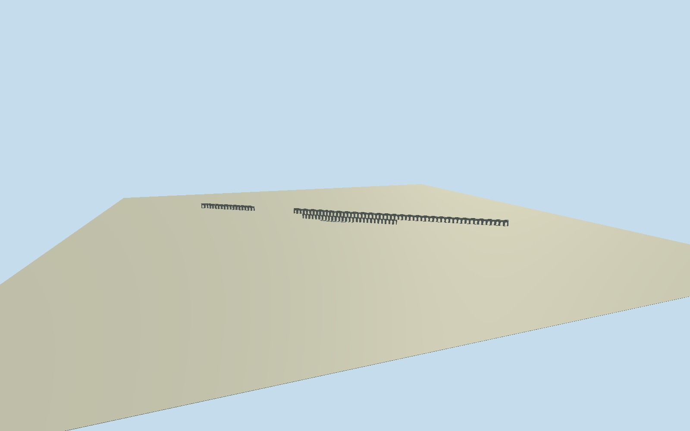

# Aqueduct of Valens

Both surviving Valens Aqueduct masonry components in Istanbul: actual deep open arches and thick piers, central two-tier arcade with semicircular/occasional pointed arch profiles, single-tier end remains, continuous high channel and low parapets, thin tier ledge, pale stone and occasional brick voussoir repairs. Exact native outlines/all61XZcontrols and missing gap retained. No reconstructed lost connecting section, road/property slab, whole water network, traffic/mosque/neighbors/vegetation/signs or interiors.

Authoring state: **review-in-qa.json**. Current completion evidence is in [qa.json](qa.json) and the [completion ledger](../../../../qualla-structures/batches/qualla-002.PROGRESS.md).

- [Aqueduct of Valens](https://qualla.com/aqueduct-of-valens/)

Two distinct native closed aqueduct outlines from original OSM way23276526/Q952924(41uniquecontrols) and way440782193(20uniquecontrols),61total. Native common bbox-midpoint anchor/+Xeast/+Zsouth/heading0; preserve separate physical remains and missing gap. Neither polygon is a whole-property area. No source floor/section/arch/span census chosen before original independent field freeze. Attribute width7.75-8.24m/height29m/length921m is original map metadata, not adopted as surveyed profiles for each remaining part.

All floor/section/geometry decisions follow original1600m513x513263169sample field/nine rawtile freeze. The original native ele63/height29 tags are unsurveyed metadata; original authored section adopts approximate absolute34m central base/63m upper channel(29m complete section), not a surveyed threshold or terrain fit. Upper tier begins14m above base, upper openings10.4m/lower11.6m, with central estimated two-tier length280m and single-tier end remnants. Flat channel and graded/ruined end mass remain original unsurveyed estimates, as do arch census/spacing/pier profiles/currentfinish. Both native outlines/all61XZcontrols and real missing gap retained. No moving/flattening/fitting/reacquiring field or raising model after contact inspection. Native width controls, rather than generic8m tagged width, govern every section. Preview/replacementfalse; exact grade/contact unresolved.

Qualla-first40families/zero conflicts; published missing/assumed creator or unbound release originals remain unselected. Three independent exact Gryffindor own/explicitPD-self July2007 exteriors individually inspected/nativeSHA1 matched establish central two-tier masonry/real deep arch vaults and upper channel. No copied pixels/textures, protected imagery, article/media/rightsmetadata repairs or questionable sources. Exact hidden end profiles/current masonry census/grade/spacing are bounded original estimates; distant skyline and district simplify arch census and omit near masonry blocks/voussoirs.

Independent1600m513x513263169sample original terrain/nine rawtiles frozen before all floors/sections/geometry; no fitting/flattening/reacquisition or subsequent raising. Fixed SW21.5521m provider datum and original estimated absolute34/63m section are not a surveyed grade. All geographic placement remains preview/replaceFootprint=false; exact grade/contact unresolved. Flat stage and neighborhood are synthetic review fixtures.

Build: `node content/worldgen/source/places/sx/sxk/aqueduct_of_valens/models/generate-aqueduct-of-valens.mjs`. Add `--check` to verify exact regeneration. 55520 triangles; 3 materials; no embedded photographs.
