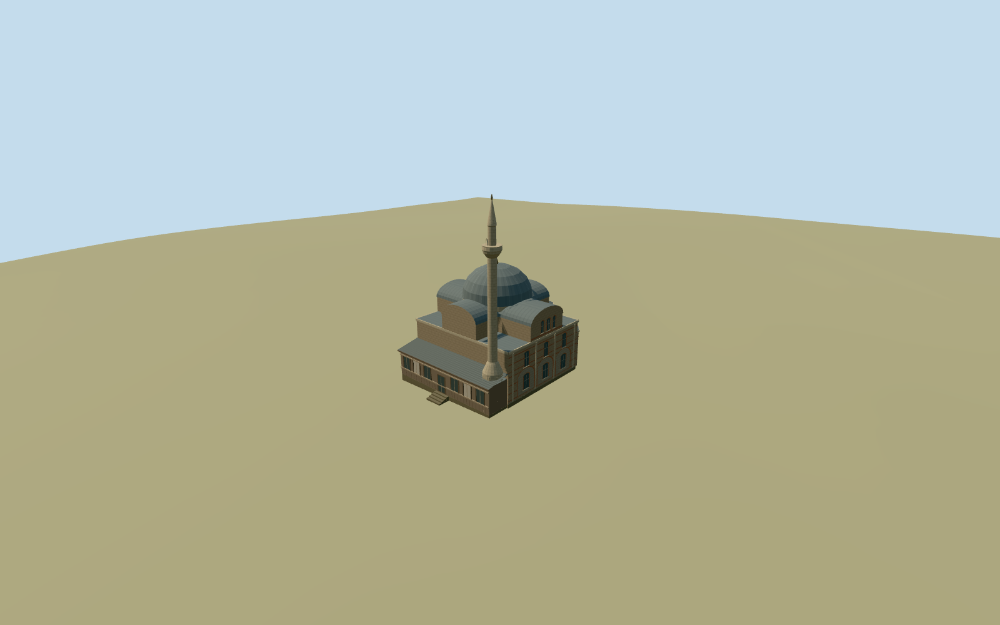

# Atik Mustafa Pasha Mosque

Atik Mustafa Pasha Mosque with a low lead dome, cross-shaped upper roof, brick-striped faceted apses, timber vestibule and one stone minaret.

Authoring state: **review-in-qa.json**. Current completion evidence is in [qa.json](qa.json) and the [completion ledger](../../../../qualla-structures/batches/qualla-003.PROGRESS.md).

- [Atik Mustafa Pasha Mosque](https://qualla.com/atik-mustafa-pasha-mosque/)

The 2025 published interior image provides dome and window evidence. Exterior heights, stone and brick color, chapel recesses and porch framing are estimated from surveyed descriptions and the named map envelope.

This model represents the standing mosque after the 2024 restoration. Painted interior surfaces, interior tomb furnishings and the separately addressed street fountain are outside scope.

Build: `node content/worldgen/source/places/sx/sxk/atik_mustafa_pasha_mosque/models/generate-atik-mustafa-pasha-mosque.mjs`. Add `--check` to verify exact regeneration. 3799 triangles; 8 materials; no embedded photographs.
