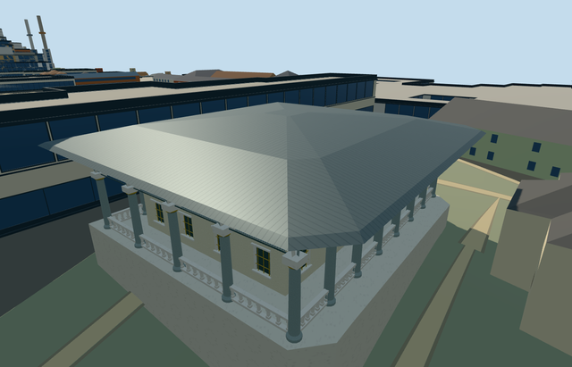

# audience_chamber_topkapi_palace — Audience Chamber, Topkapi Palace

Reviewed2026-10-21. **Complete as an individual medium-fi visualization; native terrain fit is approximate. Topkapi remains incomplete:8/18 required members ready.**

## Built and inspected

Inspected all48 final source/shared/medium-fi/native views in one continuous author/build/inspect/fix pass. Specific raised pale Audience Chamber with open round-arched portico, grey granite shafts/pale capitals/gold collars, low open balustrades, a real front entrance, closed rear leaf, recessed two-level windows and broad shallow lead canopy. Geometric pale/gold coffered soffit uses shared materials. Corrected one-sided recessed window backs discovered in the first native doorway view; they are now opaque from both room and exterior. Adjusted the corner camera to avoid the independent Gate of Felicity occluding this member. Seven earlier palace members retain their approved input/source/runtime pins. Native scene renders this member against retained native context, not a combined eight-model scene.

## Shared surfaces and browser levels

Eight existing256px graphs: plaster_lime, stone_marble, stone_granite, metal_standing_seam, wood_plain, metal_bronze_cast, tile_ceramic and metal_painted. Nine roles merge into eight textured draws/one skyline draw. Explicit metric wall/roof/tile quad UVs; opaque dark panels use trim slot with vertex tint preserved, including authored LOD bindings. No new graph/private atlas/embedded images. Each requested graph read once. Separate POSITION/NORMAL streams and equal CPU/GPU accounting.

| Level | Triangles | Bytes | Draws |
| --- | ---: | ---: | ---: |
| skyline | 938 | 80,212 | 1 |
| district | 3,588 | 342,864 | 8 |
| street | 11,716 | 1,073,372 | 8 |
| closeup | 24,840 | 2,320,164 | 8 |

Initial geometry: **423,076bytes**. Four authored levels938/3588/11716/24840triangles. Initial skyline plus district423076bytes. Skyline retains chamber, real front entry, surrounding columns/open upper arcade, bounded podium/steps and shallow hip roof. District restores balustrade openings, representative window panels and round arches. Street/closeup restore recessed opaque window backs, profiled shafts/capitals, finer arch stones, balustrades and coffered soffit. All levels satisfy triangle/download/draw/layout budgets. Physical ordinary-laptop/phone/tablet and dense-city measurements remain pending.

## Native fit

Audience Chamber member of Topkapi Q170495, OSM way103907818/native35184475996650. Native parent is the approximately31.4x29.2m canopy footprint with chamfered rear corners. Internal+X follows its long front elevation southeast; internal+Z faces southwest toward the separate Gate of Felicity. World heading0/native+X east,+Z south. Two ordinary exterior photos inspected; column/arch/door/canopy treatment is specific to this chamber. Only Audience Chamber way103907818/native35184475996650 replaced. The full mapped canopy parent is suppressed, while ground cutouts cover only the occupied podium and front stairs. All258 independent resident records of259 and572 wider records of573 remain unchanged. Seven overlapping native PMTiles cases at13/14/15 pass, including two detailed parent fragments. Original161x161/6m terrain, roads and3400906.0006393427square metres water retained. Failure keeps259 originals; every LOD unload restores ground/water and zero model geometry. Native approximate exterior fit and facing inspected. Original open front court internal[0,16] supplies modelY0. Level podiumY1.2 is above all original deck-boundary samples; only occupied deck/front stairs cut terrain. Coarse original terrain falls several metres under the east/rear side and exposes a deep protective base. This is an explicit terrain accommodation, not a verified historic podium/retaining-wall height. No precinct flattening, hidden removal of independent structures or custom terrain fetch. Historical thresholds/accessibility remain unverified.

## Limits and checks

Two ordinary exterior photos actually viewed: under-canopy detail by Osama Shukir Muhammed Amin FRCP(Glasg),2018, and whole corner by Shoakat hossain,2017. Existing standard PMTiles supplies named footprint and facing toward the separate Gate of Felicity. No qualified native architectural height. Picture-led podium1.2m above front reference, shaft/capital/arch spring near6.6m, arcade crown8.2m, soffit8.9m and low hip roof near10.8m. Enclosed chamber21x16.2m and22 working column positions/eight front-row columns are footprint/photo-led visualization controls, not verified dimensions or inventory. Fine capitals, roof plan, painted art and hidden interior arrangement remain approximate. The22working column positions, room plan, roof profile and dimensions are picture/footprint-led visualization controls, not a surveyed architectural inventory. Shared tile/metal/wood motifs substitute for bespoke decoration. No copied calligraphy/tughra/floral artwork, visitors, plants, furnishings or asserted inaccessible interior plan. This completes one member; the palace project remains incomplete.

Six GLBs: zero Khronos errors/warnings;826actual mesh/contact probes. Seven overlapping PMTiles cases13/14/15 pass. All48final source/shared/medium-fi/native views inspected. Selected source/import/placement/strict medium-fi/scene/simulation/lint checks pass. Sim30: `6bf3333365915f2fd1866d057ff1ea5f61897284a169803a70cf6c4cbb0a2903`.

Exact current hashes: [qa.json](qa.json). Editable footprint, podium, canopy and facade controls: [map-frame.json](map-frame.json). Rebuild using generate-additional-landmarks.mjs --ids=audience_chamber_topkapi_palace, import-structure-models.mjs --ids=audience_chamber_topkapi_palace and generate-landmark-lods.mjs --ids=audience_chamber_topkapi_palace --force in their existing script directories.

## Viewed photographs

- https://commons.wikimedia.org/wiki/File:The_exterior_of_the_Audience_Chamber_(the_Chamber_of_Petitions;_Arz_Odas%C4%B1)._Topkapi_Palace,_Istanbul,_Turkey.jpg — Osama Shukir Muhammed Amin FRCP(Glasg); 2018-04-26; CC-BY-SA-4.0. Viewed only; no copied pixels.

- https://commons.wikimedia.org/wiki/File:Exterior_of_the_Audience_Chamber_(Topkapi_Palace).jpg — Shoakat hossain; 2017-06-15; CC-BY-SA-4.0. Viewed only; no copied pixels.
