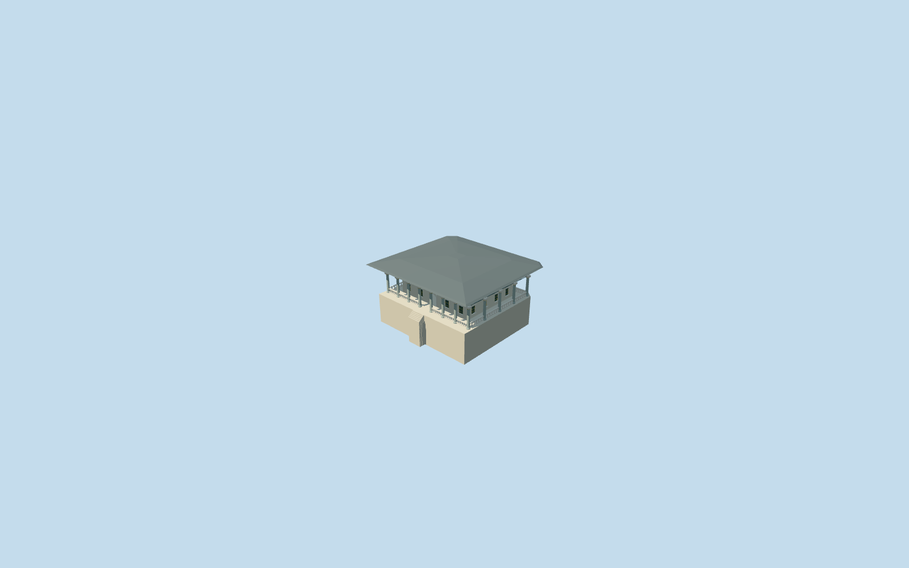

# Audience Chamber, Topkapi Palace

Specific Audience Chamber/Arz Odasi on way103907818: enclosed pale chamber, real front doorway/closed rear door and recessed two-level windows; surrounding open round-arched colonnade with grey stone shafts/pale capitals/gold collars, low open balustrade, raised occupied podium/front steps and a broad shallow lead hip canopy with geometric coffered soffit. Preserve Gate of Felicity and other independent palace members. No copied tughra/calligraphy/floral ceiling art, furnishings, visitors or surveyed interior layout.

## Evidence and reconstruction

Published dimensions and reconstructed details are separated in spec.json. Primary references:

- [Reference](https://commons.wikimedia.org/wiki/File:The_exterior_of_the_Audience_Chamber_(the_Chamber_of_Petitions;_Arz_Odas%C4%B1)._Topkapi_Palace,_Istanbul,_Turkey.jpg)
- [Reference](https://commons.wikimedia.org/wiki/File:Exterior_of_the_Audience_Chamber_(Topkapi_Palace).jpg)

Specific Audience Chamber/Arz Odasi on way103907818: enclosed pale chamber, real front doorway/closed rear door and recessed two-level windows; surrounding open round-arched colonnade with grey stone shafts/pale capitals/gold collars, low open balustrade, raised occupied podium/front steps and a broad shallow lead hip canopy with geometric coffered soffit. Preserve Gate of Felicity and other independent palace members. No copied tughra/calligraphy/floral ceiling art, furnishings, visitors or surveyed interior layout.

## Model and axes

24,840 triangles; 71,792 vertices; 8 material groups; 2,887,420 bytes. Native bounds: -20.164, -6.401, -19.601 to 20.164, 11.100, 19.601. Source hash: `sha256:277459ee2d0e5178232fb43b261ff3ad035de68784f66ea72797afc60d16fdaa`.

{"x":"east","y":"up","z":"south"}

The geographic proposal uses exact-QID OpenStreetMap evidence. Map-derived orientation and estimated architectural details require real-site visual review; preview eligibility is distinct from geographic/fidelity approval. Map attribution: © OpenStreetMap contributors, ODbL-1.0.

## Reproduce

Run `node packages/worldgen/scripts/generate-additional-landmarks.mjs --ids=audience_chamber_topkapi_palace` (or add `--check`). The generator preserves manually edited masters by checking their baseline hashes. Import through the standard authored-model workflow with optimization disabled; then capture all QA cameras, including shared-surface views.

## Pending work

- Specific Audience Chamber/Arz Odasi on way103907818: enclosed pale chamber, real front doorway/closed rear door and recessed two-level windows; surrounding open round-arched colonnade with grey stone shafts/pale capitals/gold collars, low open balustrade, raised occupied podium/front steps and a broad shallow lead hip canopy with geometric coffered soffit. Preserve Gate of Felicity and other independent palace members. No copied tughra/calligraphy/floral ceiling art, furnishings, visitors or surveyed interior layout.
- Audience Chamber member of Topkapi Q170495, OSM way103907818/native35184475996650. Native parent is the approximately31.4x29.2m canopy footprint with chamfered rear corners. Internal+X follows its long front elevation southeast; internal+Z faces southwest toward the separate Gate of Felicity. World heading0/native+X east,+Z south. Two ordinary exterior photos inspected; column/arch/door/canopy treatment is specific to this chamber.
- No qualified native architectural height. Picture-led podium1.2m above front reference, shaft/capital/arch spring near6.6m, arcade crown8.2m, soffit8.9m and low hip roof near10.8m. Enclosed chamber21x16.2m and22 working column positions/eight front-row columns are footprint/photo-led visualization controls, not verified dimensions or inventory. Fine capitals, roof plan, painted art and hidden interior arrangement remain approximate.
- Original standard PMTiles/Mapzen terrain retained. Open front court internal[0,16] supplies providerY0. Occupied podium is level atY1.2 with foundations extending below original boundary minima; only the actual podium/front steps cut ground. No courtyard flattening or precinct slab. Original ground falls several metres beneath the east/rear side, so the protective foundation may be exposed there; that extension accommodates coarse terrain and does not assert historic retaining-wall height. Native exterior fit remains draft until rendered inspection; historical thresholds/accessibility need better ground data.

This bundle follows the medium-fi standard. Medium-fi appearance and geographic fit are reviewed separately. Hash-bound visual acceptance is recorded separately after capture inspection.
