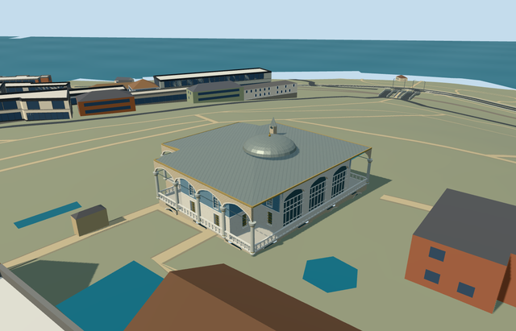

# baghdad_kiosk_topkapi_palace — Baghdad Kiosk, Topkapi Palace

Reviewed2026-10-21. **Complete as a medium-fi exterior with approximate native terrain fit. Topkapi remains incomplete12/18ready. Hasoda terrain fit remains pending.**

## Built and inspected

Inspected48 current source/shared/medium-fi/native views in one continuous author/build/inspect/fix pass. Distinct eight-corner canopy and cross-shaped blue room, open pointed galleries/round grey shafts/faceted pale capitals/gold collars, geometric open white railings, two room window levels, real northwest entrance and bounded six-tread approach, stone basement with recessed pointed openings, three tall garden glazing arches, broad lead hip and warm soffit, shallow central dome and small pointed roof stack. Corrected the first generic garden-window treatment to three full-height arched bays, aligned their header depth to the piers, fixed skyline back-facing wall visibility, reduced district shaft profiles and widened the entrance camera. 8 byte-identical PNGs reuse prior actual inspection; 40 changed frames actually inspected after these final fixes.

## Shared textures and browser LODs

Eight existing256px graphs: stone_limestone, stone_limestone_raw, stone_marble, metal_standing_seam, wood_plain, tile_glazed, metal_bronze_cast and metal_painted. Nine authored roles merge to eight textured draws/one skyline draw; column and trim share the same marble graph/slot. Every requested graph is read once; no new graph, private atlas or embedded images. Linear vertex tints with metric wall/roof UVs; dark window backs use trim and remain opaque both ways. Generic blue glazed tiles and simplified geometric grilles substitute for bespoke historical patterns; no copied picture pixels or inscriptions. Separate POSITION/NORMAL streams; CPU/GPU buffer accounting is equal.

| Level | Triangles | Bytes | Draws |
| --- | ---: | ---: | ---: |
| skyline | 889 | 82,372 | 1 |
| district | 3,577 | 337,116 | 8 |
| street | 13,901 | 1,316,948 | 8 |
| closeup | 18,237 | 1,734,616 | 8 |

Initial geometry: **419,488bytes**. Four authored LODs889/3577/13901/18237triangles. Initial skyline+district419488bytes. Skyline retains the notched canopy, raised floor, blue cross-room, dome/stack, clear entry and open galleries. District restores pointed gallery/glazing arches, all columns/collars and simple railing. Street adds recessed lower arches, window reveals/mullions, geometric rails and near capital profiles; closeup refines curves, shafts and grilles. Synthetic flat ground exposes terrain-dependent basement foundations and does not approve native fit. Physical ordinary-laptop/phone/tablet and dense-city timings remain pending.

## Native placement

Independent Q6096486 / OSM way32396296 / native35184404485128. OSM v23 explicitly names Baghdad Kiosk and repeats Q6096486. Exact eight-corner parent retained; internal+X southeast faces the garden, internal+Z southwest faces the pool court. Existing standard Protomaps20261020/Mapzen PMTiles and original161x161/6m heightfield retained. Open provider control internal[-18,0] is outside every original building record. Raised terrace/stone basement meet original coarse falling terrain; local protective foundations and bounded approach stair accommodate grade. No bespoke terrain or precinct flattening; historical thresholds/accessibility are unverified. Approximate native exterior fit inspected: the standard grid seats the raised basement, upper terrace and bounded stair. Some garden basement openings are buried by the coarse uphill grade; threshold heights remain unverified. Approximate original-terrain exterior fit/facing accepted, with some uphill garden basement recesses partly buried by the coarse native grade. Replace only way32396296/native35184404485128. All258 independent resident records of259 and572 wider records of573 retain original geometry; original161x161/6m terrain, roads and3400906.0006393427square metres water remain unchanged. Two actual overlapping PMTiles cases14/15 pass, including the detailed owned parent; no matching overlapping level13 feature was present. Provider control internal[-18,0] is outside all573 original records, remains uncovered in every LOD and provides modelWorldY approximately0. The outside pool court retains terrain. Failed loading preserves259 originals; every unload restores terrain/water and releases all model geometry. This fixture renders this kiosk against native context, not all thirteen authored palace members together.

## Fidelity and limitations

Baghdad Kiosk as a distinct notched canopy footprint with cross-shaped blue-tiled room, open pointed colonnade and white geometric terrace rails, raised stone basement with recessed pointed openings, tall glazed garden bay, two window levels, broad lead hip/eaves, shallow central lead dome and small pointed roof stack. No independent Iftar/Yerevan kiosk, pool, surrounding terrace, copied artwork or furnishings. Picture-led upper room height6.25m, broad lead hip rise1.1m and shallow central dome rise1.8m/radius4m. Upper walking floor is .25m above the highest original parent boundary sample. Cross-room proportions, opening/column inventory, roof-stack location and inaccessible roofs/interiors are reconstructed controls, not surveyed dimensions. Three ordinary photos actually viewed: Moonik2012 garden facade, Dosseman2016 outer walkway and Dosseman2008 pool-court view. Original mapped canopy is exact; the cross-room, heights, opening and column inventory, dome/stack profiles and inaccessible rear/interior arrangement are picture-led approximations. The pictures do not fully expose the roof, so the shallow dome/stack dimensions are reconstruction controls. Native grade/step heights are visualization accommodations, not verified historic thresholds or accessibility. No custom terrain, precinct flattening, furnished interior, copied inscriptions, pool or independent Iftar/Yerevan kiosk. This completes one medium-fi Baghdad Kiosk member; Topkapi remains incomplete12/18ready and Hasoda remains an inactive terrain-fit draft.

## Targeted checks

Six GLBs: zero Khronos errors/warnings;212actual mesh/contact probes;48current inspected views;two overlapping map cases14/15. Selected source/import/placement/strict medium-fi/scene/sim30/lint checks pass. Sim30 sha256:a8d7315b561ee58ba54b3cacec680edfe29766d52e718844859767253d372e67. Current pins and capture continuity: [qa.json](qa.json). Editable model controls: [map-frame.json](map-frame.json).

## Viewed references

- https://commons.wikimedia.org/wiki/File:Baghdad_Kiosk_at_the_Topkap%C4%B1_Palace_in_Istanbul,_Turkey_002.jpg — Moonik; 2012-07-01; CC-BY-SA-3.0. Viewed only; no copied pixels.

- https://commons.wikimedia.org/wiki/File:Topkap%C4%B1_Baghdad_Kiosk_Exterior_the_outer_walkway_in_2016_01_0904.jpg — Dosseman; 2016-12-09; CC-BY-SA-4.0. Viewed only; no copied pixels.

- https://commons.wikimedia.org/wiki/File:Topkap%C4%B1_Baghdad_Kiosk_Exterior_from_Revan_Kiosk_in_2008_04_36.jpg — Dosseman; 2008-02-06; CC-BY-SA-4.0. Viewed only; no copied pixels.

- https://www.openstreetmap.org/way/32396296 — v23, independently named Baghdad Kiosk/Q6096486; ©OpenStreetMap contributors, ODbL1.0.
