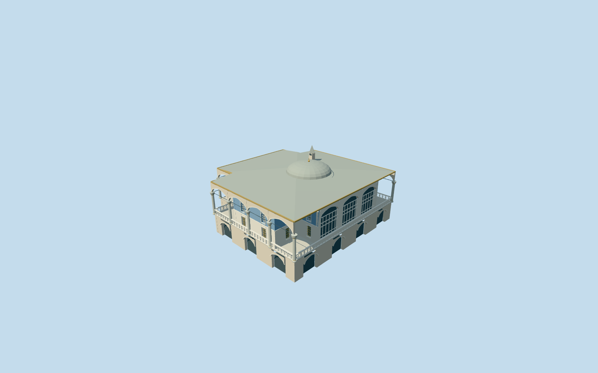

# Baghdad Kiosk, Topkapi Palace

Baghdad Kiosk as a distinct notched canopy footprint with cross-shaped blue-tiled room, open pointed colonnade and white geometric terrace rails, raised stone basement with recessed pointed openings, tall glazed garden bay, two window levels, broad lead hip/eaves, shallow central lead dome and small pointed roof stack. No independent Iftar/Yerevan kiosk, pool, surrounding terrace, copied artwork or furnishings.

## Evidence and reconstruction

Published dimensions and reconstructed details are separated in spec.json. Primary references:

- [Reference](https://commons.wikimedia.org/wiki/File:Baghdad_Kiosk_at_the_Topkap%C4%B1_Palace_in_Istanbul,_Turkey_002.jpg)
- [Reference](https://commons.wikimedia.org/wiki/File:Topkap%C4%B1_Baghdad_Kiosk_Exterior_the_outer_walkway_in_2016_01_0904.jpg)
- [Reference](https://commons.wikimedia.org/wiki/File:Topkap%C4%B1_Baghdad_Kiosk_Exterior_from_Revan_Kiosk_in_2008_04_36.jpg)

Baghdad Kiosk as a distinct notched canopy footprint with cross-shaped blue-tiled room, open pointed colonnade and white geometric terrace rails, raised stone basement with recessed pointed openings, tall glazed garden bay, two window levels, broad lead hip/eaves, shallow central lead dome and small pointed roof stack. No independent Iftar/Yerevan kiosk, pool, surrounding terrace, copied artwork or furnishings.

## Model and axes

18,237 triangles; 52,447 vertices; 8 material groups; 2,111,776 bytes. Native bounds: -17.093, -0.775, -16.989 to 17.093, 12.890, 16.989. Source hash: `sha256:8254d74d891c624f66d5776af79a53a7e2106bec5872ee4481d3be00e8e0b746`.

{"x":"east","y":"up","z":"south"}

The geographic proposal uses exact-QID OpenStreetMap evidence. Map-derived orientation and estimated architectural details require real-site visual review; preview eligibility is distinct from geographic/fidelity approval. Map attribution: © OpenStreetMap contributors, ODbL-1.0.

## Reproduce

Run `node packages/worldgen/scripts/generate-additional-landmarks.mjs --ids=baghdad_kiosk_topkapi_palace` (or add `--check`). The generator preserves manually edited masters by checking their baseline hashes. Import through the standard authored-model workflow with optimization disabled; then capture all QA cameras, including shared-surface views.

## Pending work

- Baghdad Kiosk as a distinct notched canopy footprint with cross-shaped blue-tiled room, open pointed colonnade and white geometric terrace rails, raised stone basement with recessed pointed openings, tall glazed garden bay, two window levels, broad lead hip/eaves, shallow central lead dome and small pointed roof stack. No independent Iftar/Yerevan kiosk, pool, surrounding terrace, copied artwork or furnishings.
- Independent Q6096486 / OSM way32396296 / native35184404485128. OSM v23 explicitly names Baghdad Kiosk and repeats Q6096486. Exact eight-corner parent retained; internal+X southeast faces the garden, internal+Z southwest faces the pool court.
- Picture-led upper room height6.25m, broad lead hip rise1.1m and shallow central dome rise1.8m/radius4m. Upper walking floor is .25m above the highest original parent boundary sample. Cross-room proportions, opening/column inventory, roof-stack location and inaccessible roofs/interiors are reconstructed controls, not surveyed dimensions.
- Existing standard Protomaps20261020/Mapzen PMTiles and original161x161/6m heightfield retained. Open provider control internal[-18,0] is outside every original building record. Raised terrace/stone basement meet original coarse falling terrain; local protective foundations and bounded approach stair accommodate grade. No bespoke terrain or precinct flattening; historical thresholds/accessibility are unverified.

This bundle follows the medium-fi standard. Medium-fi appearance and geographic fit are reviewed separately. Hash-bound visual acceptance is recorded separately after capture inspection.
