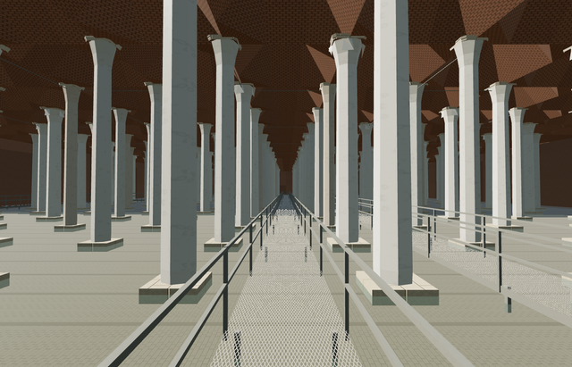

# Basilica Cistern

Istanbul’s Basilica Cistern has 336 reused shafts beneath intersecting brick vaults, a shallow reflective basin, two differently oriented Medusa pedestals and the slender visitor decks and stairs of its restored museum.

The original chamber sits beneath the continuous native city surface. The two localized shaft openings allow sight along the entrance stairs. The 12-by-28 column grid, brick vaults, water basin, steel decks and Medusa blocks have original modeled geometry.

The current viewer review confirmed both mapped stair openings, all 336 columns across the three interior detail levels, and restoration of the street surface on unload. Interior views use cameras positioned in the underground hall and on the stairs. Standard interactive navigation into the hall remains unverified.

Run the Basilica Cistern generator registered in asset-build.json to rebuild the detailed source. The four detail levels use shared brick, marble, limestone, painted iron, deck grating and ceramic roof finishes.

[Municipal museum description](https://ataturkkitapligi.ibb.gov.tr/en/Kitaplik/Muzelerimiz/Yerebatan-Cistern-Museum/11) · [Cistern plan by Marsyas and Krzysztof Zajączkowski](https://commons.wikimedia.org/wiki/File:Cistern_basilica_plan.svg)
