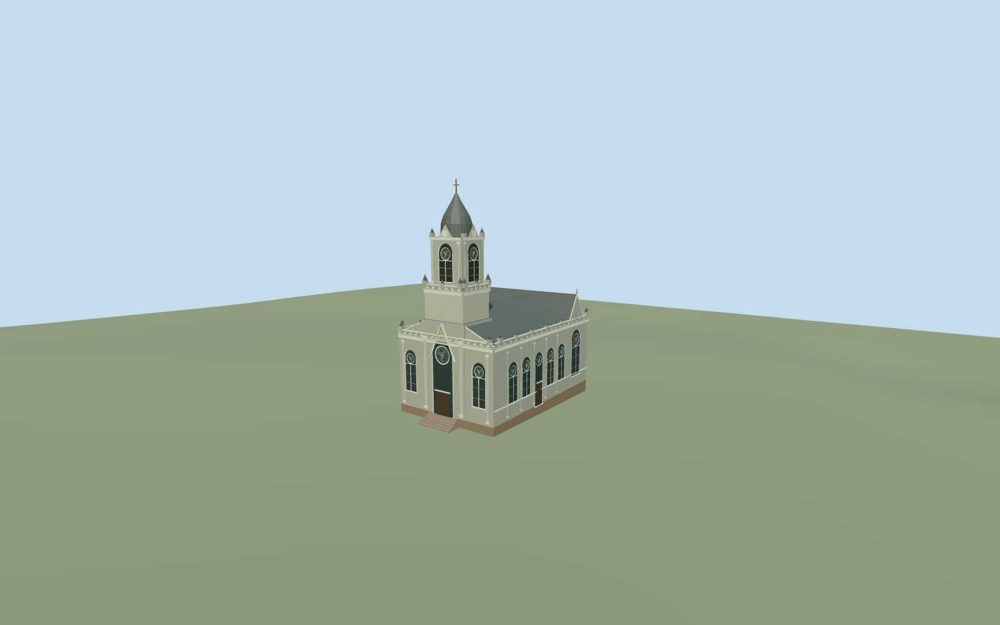

# Bulgarian St. Stephen Church

Istanbul’s Bulgarian Iron Church, with a 30 m domed bell tower, arcaded cast-iron walls, an apsidal east end and a zinc roof.

Authoring state: **review-in-qa.json**. Current completion evidence is in [qa.json](qa.json) and the [completion ledger](../../../../qualla-structures/batches/qualla-003.PROGRESS.md).

- [Bulgarian St. Stephen Church](https://qualla.com/bulgarian-st-stephen-church/)

The standing church uses the mapped footprint. The 1895 engineering publication reports 32 m overall, whereas the named current wall outline is about 27 m from the front to the apse. The mapped walls and the separately modeled approach steps govern placement.

The engineering report gives a 30 m tower including the cross. Lower roof and façade heights, the small cast pinnacles, rosette and swag profiles, colours and ornamental spacing are estimated.

The B&W periodical depicts the iron shell before shipment. Modern landscaping, yard buildings and furnishings are outside model scope. The restored paint and metal roof use approximate neutral colours identified by conservation research.

Build: `node content/worldgen/source/places/sx/sxk/bulgarian_st_stephen_church/models/generate-bulgarian-st-stephen-church.mjs`. Add `--check` to verify exact regeneration. 16379 triangles; 6 materials; no embedded photographs.
