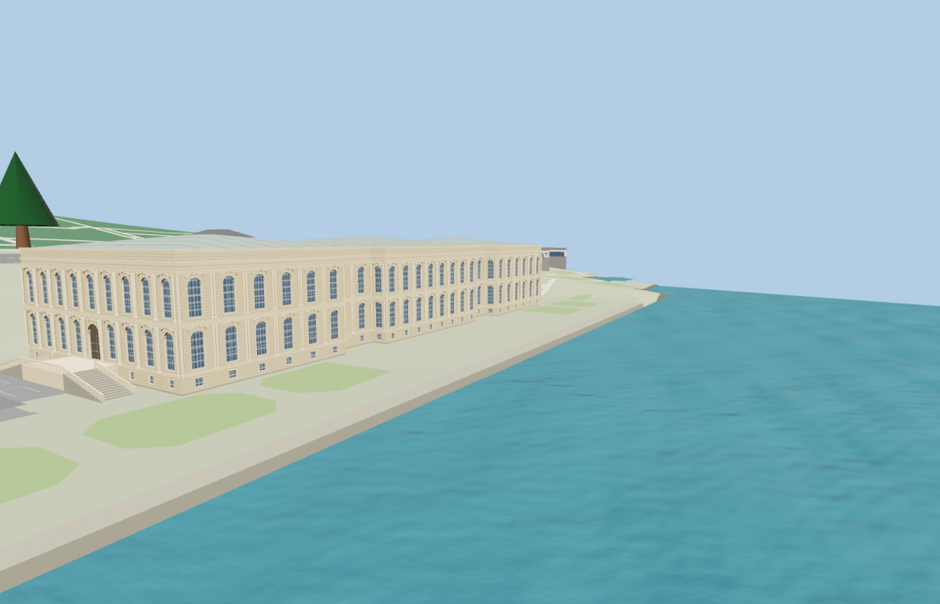

# Çırağan Palace

The principal historic exterior retains the three projecting waterfront pavilions and two inset bays, the rusticated basement, two arched window stories, shallow closed hipped roofs, and both southwest stair flights. The granite-facing strip runs only along the mapped historic court frontage.

Both stair flights meet the 3.5 m court within 9 mm at the sampled points. The granite facing ties to the quay within 26 mm at the sampled points. Local grades blend into the retained hillside and expose the existing Bosphorus water at the historic shore. No native sea or road geometry is removed.

The local fixture keeps the three nearby building records, all 61 transportation records, and both mapped water inputs. The separate production replacement test retains all 14 independent native components. Loading failure keeps the mapped palace footprint.

| Detail level | Triangles | Download bytes | Draws |
| --- | ---: | ---: | ---: |
| skyline | 193 | 18,140 | 1 |
| district | 1,082 | 100,448 | 6 |
| street | 7,115 | 638,908 | 6 |
| closeup | 60,635 | 6,209,584 | 6 |

The first two levels total 118,588 bytes. Six GLBs validated with zero errors or warnings. Four focused tests and 324 placement probes passed. 71 renders were inspected.

The 3.5 m court level, offshore bed correction and stair risers are visual estimates from the ordinary exterior photos and standard map and terrain inputs. The site grade blends into the raw hill behind the palace.

This is the principal historic exterior with its closed roofs, southwest entrance and both stair flights. A short granite-faced seawall follows the mapped line along the historic court. The independent hotel, pool, gardens, gate and remaining quay retain their map geometry.

Unseen facade details and decorative trim are original medium-fi interpretations. Ornament, letters and interiors are outside the modeled scope.

[Site controls](site-fit.json) · [QA evidence](qa.json) · [Waterfront photograph](https://www.kempinski.com/en/ciragan-palace/overview)
