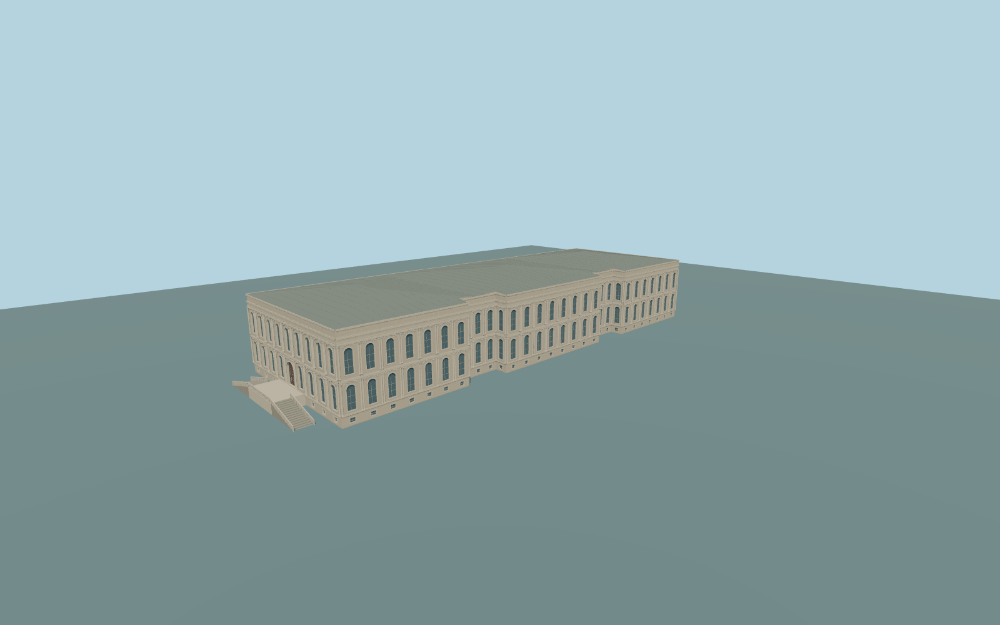

# Çırağan Palace

Complete historic principal Çırağan Palace exterior from both native clips: three projecting waterfront pavilion groups and two inset bays,two tall ornamental window stories above a low rusticated basement,paired slender columns/pilasters,original layered curved window-head frames,deep cornices and paneled attic,three closed shallow green/gray hipped roof groups,and the integral southwestern raised entrance/balcony with two genuinely divided supported exterior stair flights. All glazing and principal door are closed. No mapped or pictured open court is supported. Independent modern hotel,gardens,pool,quay,gates,helipad and estate buildings stay native. Original geometric trim replaces figurative carving,heraldry and inscriptions; interiors are outside scope.

Rebuild: `node packages/worldgen/scripts/generate-ciragan-palace.mjs`;append `--check` for exact source bytes. Select import/LOD/placement with `--ids=c_ragan_palace`. Detailed source and four browser tiers are separate ignored GLB outputs.

The 3.5 m court level, offshore bed correction and stair risers are visual estimates from the ordinary exterior photos and standard map and terrain inputs. The site grade blends into the raw hill behind the palace.

This is the principal historic exterior with its closed roofs, southwest entrance and both stair flights. A short granite-faced seawall follows the mapped line along the historic court. The independent hotel, pool, gardens, gate and remaining quay retain their map geometry.

Unseen facade details and decorative trim are original medium-fi interpretations. Ornament, letters and interiors are outside the modeled scope.

Original geometry:repository license. Map:© OpenStreetMap contributors,ODbL-1.0;Protomaps. Standard terrain:terrain-grid.json. Ordinary pictures stay local and are not redistributed or used as textures. Current acceptance:qa.json.
