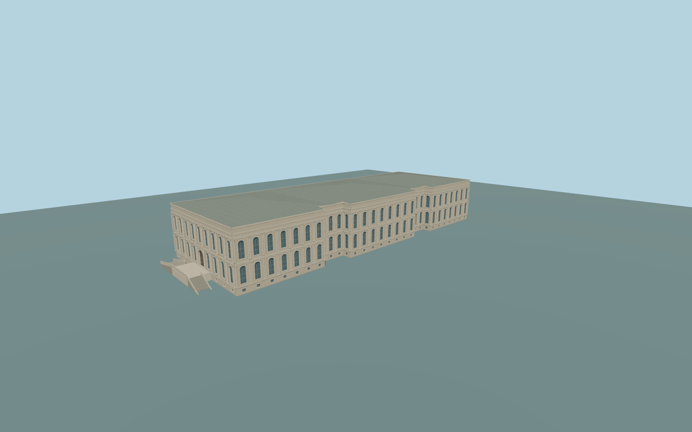

# Çırağan Palace

Complete historic principal Çırağan Palace exterior from both native clips: three projecting waterfront pavilion groups and two inset bays,two tall ornamental window stories above a low rusticated basement,paired slender columns/pilasters,original layered curved window-head frames,deep cornices and paneled attic,three closed shallow green/gray hipped roof groups,and the integral southwestern raised entrance/balcony with two genuinely divided supported exterior stair flights. All glazing and principal door are closed. No mapped or pictured open court is supported. Independent modern hotel,gardens,pool,quay,gates,helipad and estate buildings stay native. Original geometric trim replaces figurative carving,heraldry and inscriptions; interiors are outside scope.

Rebuild: `node packages/worldgen/scripts/generate-ciragan-palace.mjs`;append `--check` for exact source bytes. Select import/LOD/placement with `--ids=c_ragan_palace`. Detailed source and four browser tiers are separate ignored GLB outputs.

Complete historic principal Çırağan Palace exterior from both native clips: three projecting waterfront pavilion groups and two inset bays,two tall ornamental window stories above a low rusticated basement,paired slender columns/pilasters,original layered curved window-head frames,deep cornices and paneled attic,three closed shallow green/gray hipped roof groups,and the integral southwestern raised entrance/balcony with two genuinely divided supported exterior stair flights. All glazing and principal door are closed. No mapped or pictured open court is supported. Independent modern hotel,gardens,pool,quay,gates,helipad and estate buildings stay native. Original geometric trim replaces figurative carving,heraldry and inscriptions; interiors are outside scope.

Native principal parts have no height tags. Picture-guided approximate2.4m basement,first-story glazing3.0–8.2m,second-story glazing10.1–15.3m,19m attic/eave and2.4m shallow roof rise above the common source base. The current standard global field uses an11m reference,not a surveyed historic floor. Two unchanged standard Terrarium tiles show strong coastal urban-surface bias,with lower outer waterfront samples around3–7m. This provisional geographic datum must pass visual native fit; an oversized coastal plinth must remain an explicit unresolved issue rather than a readiness approval.

Two ordinary front/aerial pictures inspected. Hidden rear/window inventories,original simplified curved trim,roof seam details,divided stair dimensions and historic grades are medium-fi approximations. The map supplies the principal footprint and signed frame but no roof/height parts. Coastal ground fit is provisional because the coarse global field is biased upward around the palace. Numeric LOD errors and physical-device timings are unmeasured.

Five existing shared256px limestone,granite,painted metal,wood andwindow-grid graphs in six material groups. Metric UVs/linear colors,zero private or embedded images andsix draws maximum. Skyline retains the complete principal plan,three waterfront pavilions,closed hips,landing andtwo simplified stair approaches;district has closed window proxies;street closed recesses/pilasters;close-up adds paired columns,original curved window heads,paneled attic,roof seams andopen stair balustrades. Detailed source retains finer framing/curves. Native terrain fit remains provisional. Numeric LOD errors andphysical timings are unmeasured.

Original geometry:repository license. Map:© OpenStreetMap contributors,ODbL-1.0;Protomaps. Standard terrain:terrain-grid.json. Ordinary pictures stay local and are not redistributed or used as textures. Current acceptance:qa.json.
