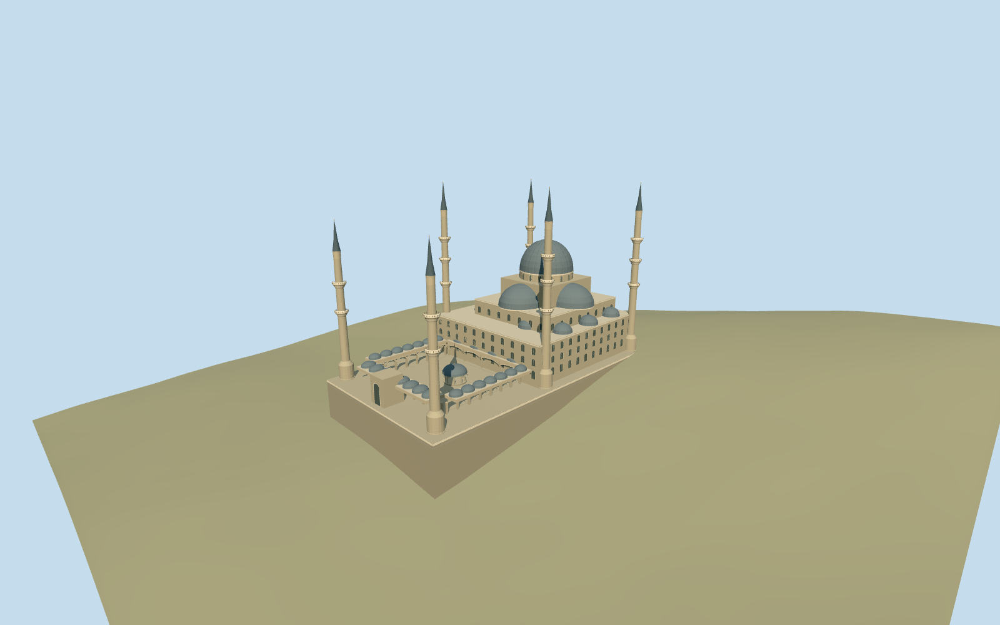

# Çamlıca Mosque

The standing Grand Çamlıca Mosque with its raised hilltop terrace, six minarets, cascaded lead roofs and domed colonnades around the court.

Authoring state: **review-in-qa.json**. Current completion evidence is in [qa.json](qa.json) and the [completion ledger](../../../../qualla-structures/batches/qualla-003.PROGRESS.md).

- [Çamlıca Mosque](https://qualla.com/caml-ca-mosque/)

The main 34 m roof and six 107.1 m or 90 m minarets use documented dimensions. Spacing and footprints follow the native map. Subordinate semi-domes, arcades, fenestration, terrace, colors, finish and ornamental detail are approximate.

The original published Qualla view is distant. Exterior detail is derived from factual records and the mapped geometry. The below-terrace museum interior, underground garage, subway, detached visitor facilities and interior calligraphy are outside scope.

Build: `node content/worldgen/source/places/sx/sxk/camlica_mosque/models/generate-camlica-mosque.mjs`. Add `--check` to verify exact regeneration. 26899 triangles; 6 materials; no embedded photographs.
