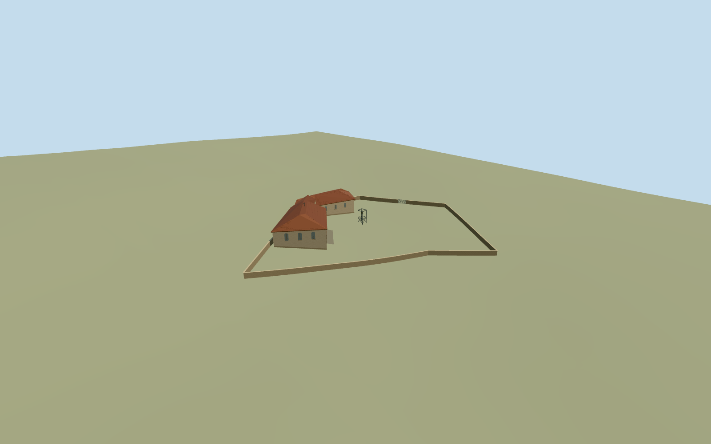

# Church of St. Mary of Blachernae

The standing tile-roofed Greek Orthodox church of St. Mary of Blachernae, glazed narthex and a simple bell frame in the walled Ayvansaray garden.

Authoring state: **review-in-qa.json**. Current completion evidence is in [qa.json](qa.json) and the [completion ledger](../../../../qualla-structures/batches/qualla-003.PROGRESS.md).

- [Church of St. Mary of Blachernae](https://qualla.com/church-of-st-mary-of-blachernae/)

The model represents the standing nineteenth-century church and garden, whose documented identity survives on this site. The Qualla illustration is of the medieval building.

The native survey establishes the building envelope and yard. Roof pitch and divisions, door and window placements, colors and the minor ironwork are reconstructed estimates.

The bell frame follows the 1947 description. Its present form and exact garden position are uncertain. Interior spring, paintings, fixtures and sculptures are outside the modeled exterior.

Build: `node content/worldgen/source/places/sx/sxk/church_of_st_mary_of_blachernae/models/generate-church-of-st-mary-of-blachernae.mjs`. Add `--check` to verify exact regeneration. 3432 triangles; 8 materials; no embedded photographs.
