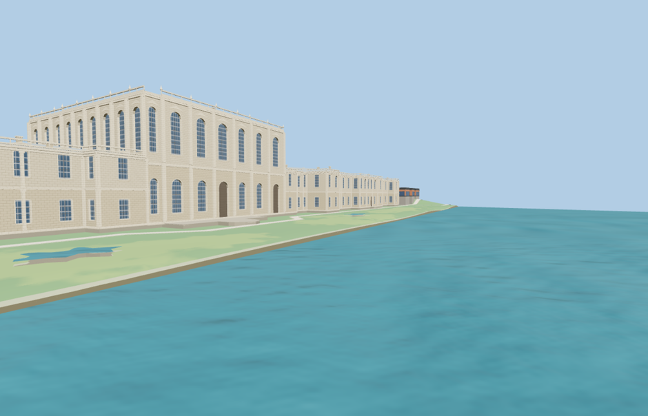

# Dolmabahçe Palace

The connected Dolmabahçe Palace exterior includes the selamlik, ceremonial hall, harem waterfront and inland return. Its hipped roofs, recessed glazing, pilasters and lanterns carry through the browser detail levels.

The three principal mapped building records align with the original signed footprint. The bounded 3.18 m court grade exposes the shallow plinth. The three rebuilt stairs meet the sampled finished court or mapped footway within 12 mm at all four detail levels.

The fixture retains 26 neighboring buildings, 33 transportation records and native water. A failed download restores all three mapped palace components. Unload restores ground and land cover and releases the model geometry.

| Detail level | Triangles | Download bytes | Draws |
| --- | ---: | ---: | ---: |
| skyline | 982 | 95,992 | 1 |
| district | 3,928 | 360,724 | 6 |
| street | 13,860 | 1,280,748 | 6 |
| closeup | 63,664 | 5,953,480 | 6 |

Skyline and district total 456,716 bytes. Six GLBs and 310 placement probes passed. The review covers 77 current renders.

The court and shore grades and the stair proportions are estimates from the standard terrain and ordinary exterior photos.

The seawall, grounds, gates and detached estate buildings remain in the basemap. Ornament and exterior roof details are simplified for medium-fi. Isolated turntables expose foundation geometry that sits below the Earth viewer’s fitted grade.

[Mapped site frame](map-frame.json) · [Terrain fit](site-fit.json) · [QA evidence](qa.json)
