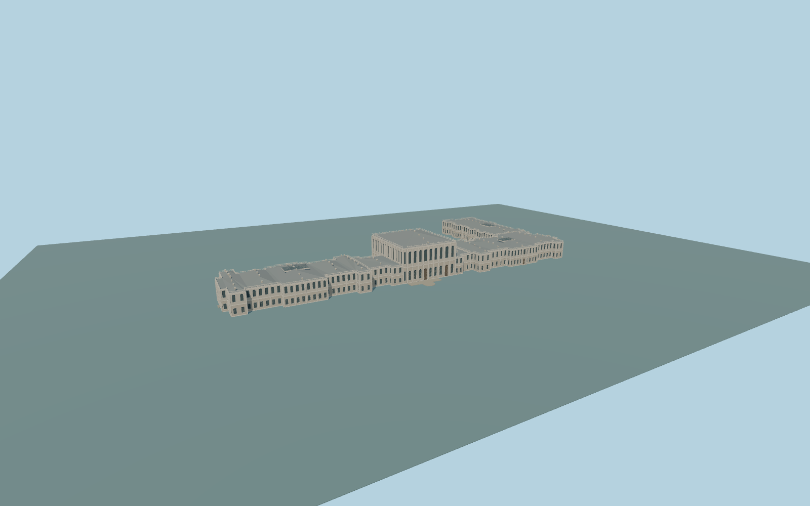

# Dolmabahçe Palace

Complete connected principal Dolmabahçe Palace exterior: two-story pale selamlik/main-entry group, much taller ceremonial hall and flanking links, long harem waterfront and full inland return. Real recessed closed windows/doors, paired pilasters, layered cornices, original simplified pediments, parapets, gray hipped roofs and glazed roof lanterns. Principal native plan and front rounded stair are retained; two submeter seam strips close native digitization gaps between the three attached groups. Detached pavilion/museum, clock tower, mosque, garden gates, seawall, red-roofed services, gardens and city remain independent. No copied heraldry, text, statues or interiors.

Rebuild: `node packages/worldgen/scripts/generate-dolmabahce-palace.mjs`;append `--check` for exact source bytes. Select import/LOD/placement with `--ids=dolmabahce_palace`. Detailed source and four browser tiers are separate ignored GLB outputs.

Complete connected principal Dolmabahçe Palace exterior: two-story pale selamlik/main-entry group, much taller ceremonial hall and flanking links, long harem waterfront and full inland return. Real recessed closed windows/doors, paired pilasters, layered cornices, original simplified pediments, parapets, gray hipped roofs and glazed roof lanterns. Principal native plan and front rounded stair are retained; two submeter seam strips close native digitization gaps between the three attached groups. Detached pavilion/museum, clock tower, mosque, garden gates, seawall, red-roofed services, gardens and city remain independent. No copied heraldry, text, statues or interiors.

Picture-guided approximate two-story15m palace eaves,27m ceremonial-hall eave/6m roof rise and14.5m inland-return eaves. Standard global DEM reference11m; floor11.8m, not surveyed historic thresholds. Native forecourt/gardens remain unmodified except exact occupied footprints and three small supported entrance aprons. Height is inferred from ordinary pictures and mapped proportions, not a surveyed roof height.

Medium-fi original simplified ornament, approximate rear elevations/window inventories and concealed roof joints. No mapped inner holes occur in the three retained principal components; visible roof lanterns are closed glazing rather than invented open courtyards. Gardens, gates and detached estate buildings stay native. Numerical LOD error and physical laptop/phone timings remain unmeasured.

Five existing shared256px limestone,granite,painted-metal,painted-wood andwindow-grid graphs; six material slots. Metric UVs/linear colors; no private or embedded images. Four authored browser tiers preserve the complete individual footprint/tall hall/inland return. District closed proxies, street real recesses, close-up pilasters/cornices/open balustrades/roof-lantern frames; master retains finer ornament and mullions. Physical timings and numerical LOD errors remain unmeasured.

Original geometry:repository license. Map:© OpenStreetMap contributors,ODbL-1.0;Protomaps. Standard terrain:terrain-grid.json. Ordinary pictures stay local and are not redistributed or used as textures. Current acceptance:qa.json.
