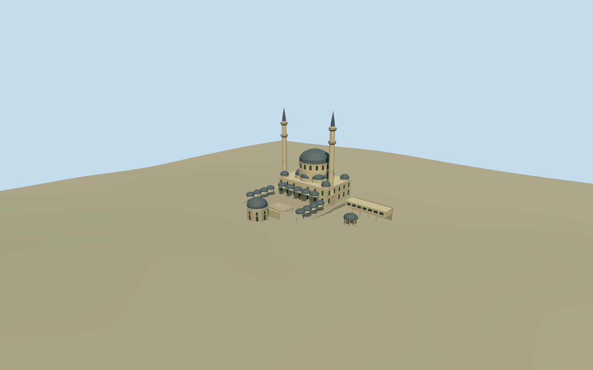

# Eyüp Sultan Mosque

Eyüp Sultan Mosque with its eight exedras, two double-balcony minarets, portico, open arcade court, domed tomb and outside fountain.

Authoring state: **review-in-qa.json**. Current completion evidence is in [qa.json](qa.json) and the [completion ledger](../../../../qualla-structures/batches/qualla-003.PROGRESS.md).

- [Eyüp Sultan Mosque](https://qualla.com/eyup-sultan-mosque/)

The standing complex retains the 1800 mosque and earlier tomb. Main hall and courtyard subdivisions, small window rhythms and cupola heights are estimated from the measured descriptions and native archival photographs.

The original photographs date from 1880–1893. Present external shapes are continued where supported by the current map and architectural inventory. The tomb’s exterior tile panels are simplified, and interiors, large trees and separately identified nearby monuments are outside scope.

Native regional terrain establishes broad grade and foundation contact. The exact lanes, stairs and resurfaced paving details are approximate.

Build: `node content/worldgen/source/places/sx/sxk/eyup_sultan_mosque/models/generate-eyup-sultan-mosque.mjs`. Add `--check` to verify exact regeneration. 17056 triangles; 6 materials; no embedded photographs.
