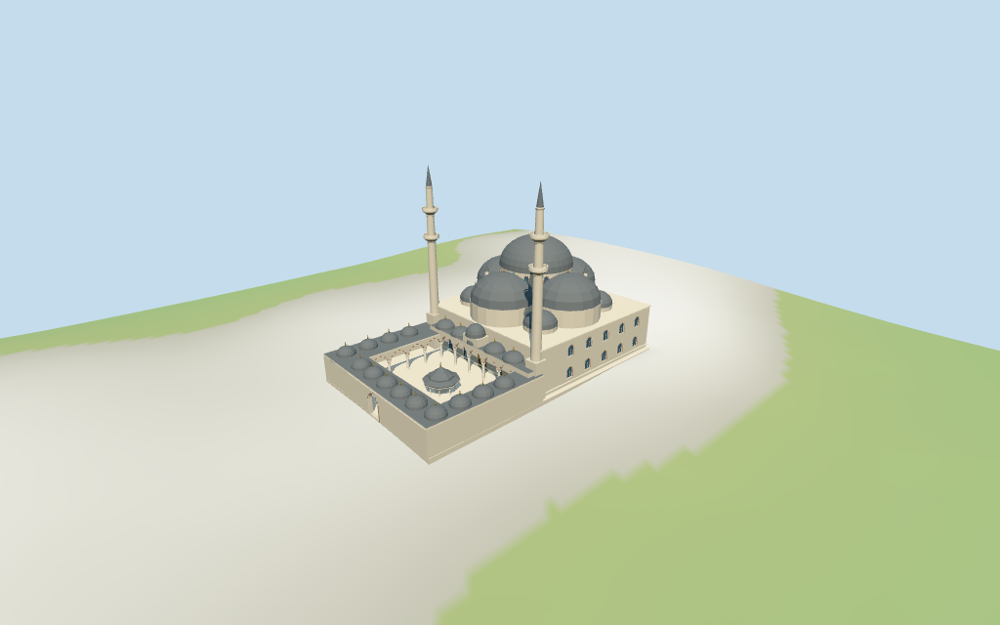

# Fatih Istanbul Mosque

Individual medium-fi Fatih Istanbul Mosque: central stepped dome composition, two double-balcony minarets, pale masonry hall with recessed windows, open courtyard arcades with muted red/cream arch wedges, grey cap roof rows, entry gate and polygonal fountain canopy. Coarse mapped compound and roof controls retained; detailed partitions and all heights estimated from two pictures. Six existing shared 256² graphs, seven merged roles and four budgeted LODs. Fine art, furnishings, adjacent monuments and unseen interiors omitted.

## Evidence and reconstruction

Published dimensions and reconstructed details are separated in spec.json. Primary references:

- [Reference](https://commons.wikimedia.org/wiki/File:Fatih_Camii_-_Aerial_view.jpg)
- [Reference](https://commons.wikimedia.org/wiki/File:Fatih_Mosque_9276.jpg)

Six existing shared 256² limestone, marble, continuous sandstone, standing-seam metal, cast bronze and wood graphs serve seven merged roles. Metric UVs, linear tints and zero embedded images. Alternating original arch wedges abstract muted red/cream masonry; no copied carving or calligraphy.

## Model and axes

20,736 triangles; 62,208 vertices; 7 material groups; 2,492,588 bytes. Native bounds: -48.600, -2.022, -28.182 to 48.615, 63.869, 28.092. Source hash: `sha256:c1922a27083cf24fba19550e4a0435ba69a6c2be88000dbaeacd6eb1a3ff14fa`.

{"x":"ESE prayer hall","y":"up","z":"WSW across compound"}

Normal viewer DEM datum 67.72154996927203 m; working floor -0.13075789090534046 m is median of 104 outside-perimeter samples at 1 m offset plus 0.3 m. 627 raw footprint samples span -1.6073752357291653..2.284126765777941 m. Adaptive footings follow the mapped outline; preview terrain seats the compound and 1.5 m margin. Full compound ground cutout is covered by paving, with the courtyard open above its floor. Precise stairs, thresholds, paving grades and terrain joins remain unverified.

## Reproduce

Run `node packages/worldgen/scripts/generate-additional-landmarks.mjs --ids=fatih_istanbul_mosque` (or add `--check`). The generator preserves manually edited masters by checking their baseline hashes. Import through the standard authored-model workflow with optimization disabled; then capture all QA cameras, including shared-surface views.

## Pending work

- Exact retained relation 1661399 / Q756189 is current viewer building 52776559794647. Its four outer vertices and four-vertex open courtyard, original anchor and heading remain fixed. Current coarse roof parts 52776562410717/720 retain raw polygons and properties; neither has height tags. Positive X ESE points from the WNW courtyard toward the prayer hall, positive Z WSW across its width. Pictures resolve this signed axis. The circular rear roof control guides one lower roof mass; detailed roof semantics are approximate. Surrounding medreses, tombs, gardens and city remain host content.
- No retained or current map height tags are available. All vertical dimensions are explicit picture estimates: main hall eaves 16 m, cross-dome supports 22 m, central drum 26–31 m, central cap 31–41 m plus 1.5 m finial; two minaret tips 64 m with balcony bands near 40 and 49 m. Courtyard eaves 9 m, lower cap domes to 11.5 m, central hall-entry roof to 17 m; fountain canopy to 8 m. These are visualization dimensions, not surveyed facts. Minor caps, stairs, arch depths, facade rhythm and unseen faces are original medium-fi approximations.
- Normal viewer DEM datum 67.72154996927203 m; working floor -0.13075789090534046 m is median of 104 outside-perimeter samples at 1 m offset plus 0.3 m. 627 raw footprint samples span -1.6073752357291653..2.284126765777941 m. Adaptive footings follow the mapped outline; preview terrain seats the compound and 1.5 m margin. Full compound ground cutout is covered by paving, with the courtyard open above its floor. Precise stairs, thresholds, paving grades and terrain joins remain unverified.
- Compound exterior with open arcades and fountain canopy; hall recesses stop at closed doors/panes. All heights and internal roof partitions are picture estimates. Fine carving, artwork, exact fountain fixtures, engineering, furnished interiors, current restoration state and physical-device timings remain unverified. Adjacent medreses, tombs and gardens remain host content.

This bundle follows the medium-fi standard. Medium-fi appearance and geographic fit are reviewed separately. Hash-bound visual acceptance is recorded separately after capture inspection.

## Additional geographic data

©OpenStreetMap contributors; Protomaps; Mapzen/USGS terrain tiles.
