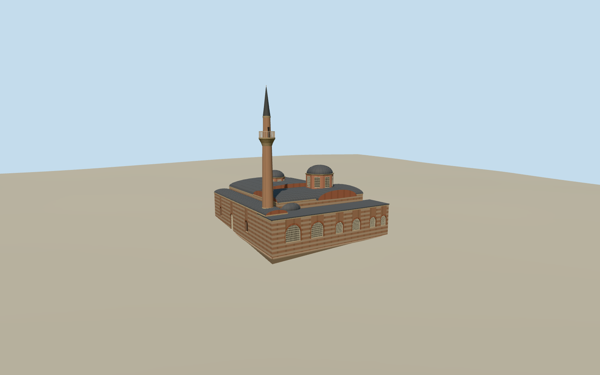

# Fenari İsa Mosque

Fenari İsa Mosque in Fatih with two Byzantine church volumes, banded masonry, six grilled boulevard windows, lead domes and a slender Ottoman minaret.

Authoring state: **review-in-qa.json**. Current completion evidence is in [qa.json](qa.json) and the [completion ledger](../../../../qualla-structures/batches/qualla-003.PROGRESS.md).

- [Fenari Isa Mosque](https://qualla.com/fenari-isa-mosque/)

The model depicts the September 2020 exterior, with the joined church volumes and later minaret.

Mapped footprint and documented church layout constrain the reconstruction. Roof sections, rear windows, apses and ornamental bands are working estimates.

The original terrain remains intact. The foundation uses approximate local paving grade.

Build: `node content/worldgen/source/places/sx/sxk/fenari_isa_mosque/models/generate-fenari-isa-mosque.mjs`. Add `--check` to verify exact regeneration. 21083 triangles; 6 materials; no embedded photographs.
