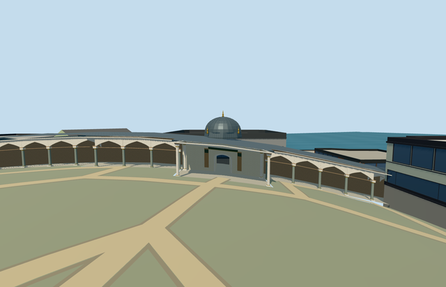

# gate_of_felicity_topkapi_palace — Gate of Felicity, Topkapı Palace

Reviewed 2026-10-21. **Individual member complete to Molen’s medium-fi standard. Topkapı Palace remains incomplete: 3 of 18 required members.**



## Built and inspected

The named gate and its connected mapped arcade wings: low cream gatehouse, open through-passage, projecting four-column canopy, polygonal lead drum, faceted dome and five gold finials. Closer levels add grey-green rear and wing shafts, pale capitals and gold collars, pointed arches, an open rear balustrade and simple timber paneling. Original geometric accents replace painted ceiling scenes and inscriptions. The Audience Chamber is an independent building.

Two ordinary exterior photographs and the existing standard PMTiles informed one continuous author/build/inspect pass. Far and district profiles were simplified to meet their budgets. All 48 final source, shared-material, medium-fi and native views were inspected. Source turntables show the complete terrain-adapted geometry; flat control stages bury the descending eastern wing. Those stages establish material and LOD appearance, not geographic contact.

## Shared materials and downloads

Eight existing 256² graphs serve nine roles: lime plaster, brick, marble, limestone, standing-seam metal, timber, bronze and granite. No new graph, private atlas or embedded images. Each requested graph is read once. POSITION and NORMAL use separate buffers; CPU/GPU geometry accounting agrees.

| Level | Triangles | Bytes | Draws |
| --- | ---: | ---: | ---: |
| Skyline | 990 | 95,576 | 1 |
| District | 3,506 | 335,200 | 8 |
| Street | 13,982 | 1,345,444 | 8 |
| Closeup | 17,682 | 1,681,128 | 8 |

Initial skyline plus district: **430,776 bytes**. Physical laptop, phone/tablet and dense-city timing measurements remain pending.

## Placement and limits

Individual Q6041550, OSM way32396111/native35184404484943. The approximately 97 × 22 m notched gate-and-wing outline fixes placement. Native +X is east, +Z south, heading 0; the internal front wall runs east-southeast, with the canopy toward the Second Courtyard south-southwest. Signed facing is a picture-led approximation with roughly 10° uncertainty.

The front-path control internal[3.8,23] sets Y0; the rear control supplies the passage slope. Nine standard-ground controls guide the connected wings, including a substantial eastern descent. This is an approximate adaptation to the existing host terrain, not a surveyed historic floor or roof leveling plan. Heights, bay inventory, profiles and inaccessible roof detail are picture-led approximations.

Native overall/front fit is accepted. The independent Audience Chamber shell meets the rear boundary and hides a distant rear view; the intact rear portico was inspected from inside its own footprint. All 258 independent resident buildings of 259 and all 572 wider independent records of 573 remain unchanged. The original 161 × 161 / 6 m terrain samples, roads and 3,400,906.0006393427 m² of native water are retained. Only the occupied parent ground opens. Failed loading keeps all 259 original buildings; unloading every LOD restores ground/water and releases all model geometry. Exact thresholds, accessibility and host terrain accuracy are not certified.

## Verification

- Six GLBs: zero Khronos errors or warnings.
- 216 actual geometry/contact probes, including the route, canopy columns, dome, finial, rear shafts and occupied notched floor.
- Nine actual overlapping PMTiles cases at levels 13, 14 and 15.
- Targeted source rebuild, import/hash, placement, strict medium-fi, scene validation, 30-tick simulation and lint pass.
- Sim30: `sha256:2db2b3567bfc0de18cdd1135c9438ca4cd6e965729064d476bc212c033245e99`.

Current file/input hashes and inspected frame bindings are in [qa.json](qa.json).

## Rebuild from source

```sh
node packages/worldgen/scripts/generate-additional-landmarks.mjs --ids=gate_of_felicity_topkapi_palace
node packages/worldgen/scripts/import-structure-models.mjs --ids=gate_of_felicity_topkapi_palace
node packages/tooling/scripts/generate-landmark-lods.mjs --ids=gate_of_felicity_topkapi_palace --force
```

## Ordinary picture references

- [Second Courtyard front](https://commons.wikimedia.org/wiki/File:Gate_of_Felicity_(Topkap%C4%B1_Palace)-.jpg): Yair Haklai, 2023-04-16, CC-BY-SA-4.0.
- [Third Courtyard rear](https://commons.wikimedia.org/wiki/File:Topkap%C4%B1_Second_courtyard_Back_of_the_Gate_of_Felicity_in_2016_17_0857.jpg): Dosseman, 2016-12-09, CC-BY-SA-4.0.

Photos were viewed only; no image pixels, ceiling paintings or calligraphy were copied.
