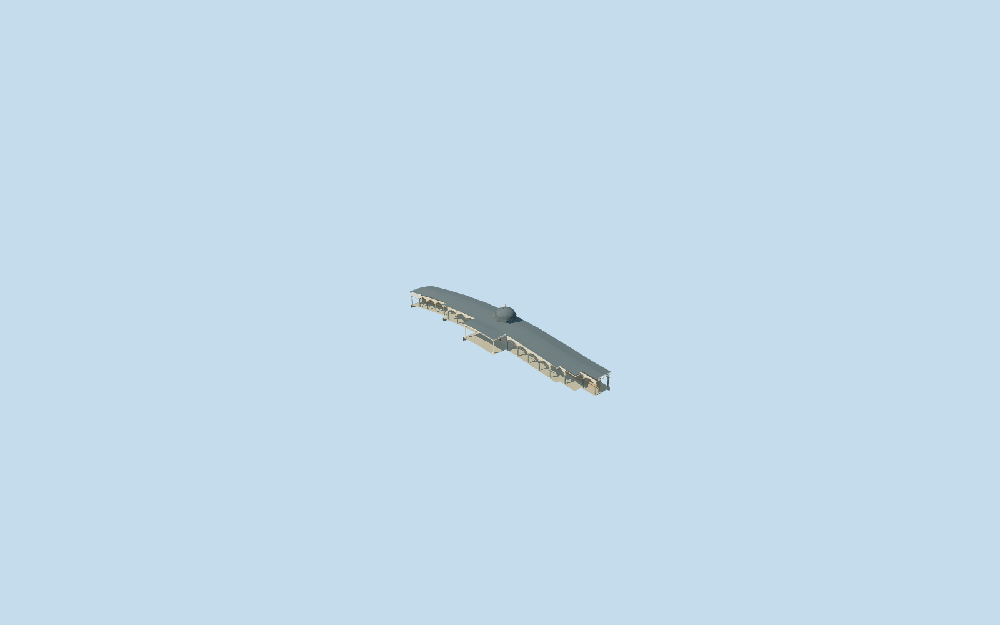

# Gate of Felicity, Topkapi Palace

Gate of Felicity (Babussaade) and the connected mapped arcade wings only, third authored member of18 required Topkapi Palace structures. Low cream gatehouse, actual open lower route, projecting four-column canopy with wide eaves, polygonal lead drum and faceted dome/five gold finials, pale front shafts, grey-green rear/wing columns and pointed arcades, rear open balustrade and occupied stone floor. Fine ceiling scenes/calligraphy/tughra, furnishings, visitors, security equipment and the independent Audience Chamber remain outside this model. Long connected wings use a simple repeated arcade rhythm and standard-ground-following floor/roof controls; exact bay inventory and historical thresholds are approximate.

## Evidence and reconstruction

Published dimensions and reconstructed details are separated in spec.json. Primary references:

- [Reference](https://commons.wikimedia.org/wiki/File:Gate_of_Felicity_(Topkap%C4%B1_Palace)-.jpg)
- [Reference](https://commons.wikimedia.org/wiki/File:Topkap%C4%B1_Second_courtyard_Back_of_the_Gate_of_Felicity_in_2016_17_0857.jpg)

Gate of Felicity (Babussaade) and the connected mapped arcade wings only, third authored member of18 required Topkapi Palace structures. Low cream gatehouse, actual open lower route, projecting four-column canopy with wide eaves, polygonal lead drum and faceted dome/five gold finials, pale front shafts, grey-green rear/wing columns and pointed arcades, rear open balustrade and occupied stone floor. Fine ceiling scenes/calligraphy/tughra, furnishings, visitors, security equipment and the independent Audience Chamber remain outside this model. Long connected wings use a simple repeated arcade rhythm and standard-ground-following floor/roof controls; exact bay inventory and historical thresholds are approximate.

## Model and axes

17,682 triangles; 53,046 vertices; 8 material groups; 2,126,664 bytes. Native bounds: -45.915, -11.270, -26.877 to 45.915, 11.932, 26.877. Source hash: `sha256:337e05137e257792295fd557f29463ff21ba5a6e4e515eb0c9ef5c6d6f693143`.

{"x":"east","y":"up","z":"south"}

The geographic proposal uses exact-QID OpenStreetMap evidence. Map-derived orientation and estimated architectural details require real-site visual review; preview eligibility is distinct from geographic/fidelity approval. Map attribution: © OpenStreetMap contributors, ODbL-1.0.

## Reproduce

Run `node packages/worldgen/scripts/generate-additional-landmarks.mjs --ids=gate_of_felicity_topkapi_palace` (or add `--check`). The generator preserves manually edited masters by checking their baseline hashes. Import through the standard authored-model workflow with optimization disabled; then capture all QA cameras, including shared-surface views.

## Pending work

- Gate of Felicity (Babussaade) and the connected mapped arcade wings only, third authored member of18 required Topkapi Palace structures. Low cream gatehouse, actual open lower route, projecting four-column canopy with wide eaves, polygonal lead drum and faceted dome/five gold finials, pale front shafts, grey-green rear/wing columns and pointed arcades, rear open balustrade and occupied stone floor. Fine ceiling scenes/calligraphy/tughra, furnishings, visitors, security equipment and the independent Audience Chamber remain outside this model. Long connected wings use a simple repeated arcade rhythm and standard-ground-following floor/roof controls; exact bay inventory and historical thresholds are approximate.
- Individual Gate of Felicity Q6041550 and OSM way32396111/native35184404484943. Its approximately97x22m notched connected gate-and-wing footprint fixes shape and placement. The projecting canopy lies on the Second Courtyard side southwest. Internal+X follows the front wall east-southeast; internal+Z faces Second Courtyard south-southwest, internal-Z the Third Courtyard north-northeast. Native world+X east/+Z south at heading0. The Audience Chamber is separately mapped immediately behind and remains independent.
- Picture-led working wing eaves about6m above local occupied floor, central octagonal drum to8.15m, faceted lead dome to11.5m and main finial to12.95m; canopy shafts to5.15m and wing/rear shafts to3.65m. Portal clear width3.1m, spring2.7m/rise0.75m above local grade. These heights, eave curves, arch profiles, shaft spacing, gold finial shapes and paneled-door proportions are approximate visualization geometry, not surveyed dimensions, exact current condition or engineering/access certification. Recognition comes from the dome, deep columned canopy, real route and side arcades; fine painted ceiling art is excluded.
- Existing standard PMTiles/Mapzen terrain retained. Native front-path control internal[3.8,23] sets Y0; rear control[3.8,-12] defines the modest through-passage cross slope. Connected wings follow nine front-ground samples along their length, preserving original terrain outside the tightly occupied mapped parent. Roof/floor subdivisions follow those controls; columns remain upright. This is an explicit approximate adaptation to the host terrain, whose eastern wing drops several metres. No broad courtyard slab, terrain flattening, independent-building replacement or water cutout. Original native terrain, footprint ownership, front-facing entry and approximate exterior contact were visually inspected2026-10-21 and accepted. The independent Audience Chamber procedural shell meets the rear boundary and obscures a distant rear view; the authored rear portico remains intact and is inspected from inside its own footprint. Exact historical wing levels and host terrain accuracy remain approximate.

This bundle follows the medium-fi standard. Medium-fi appearance and geographic fit are reviewed separately. Hash-bound visual acceptance is recorded separately after capture inspection.
