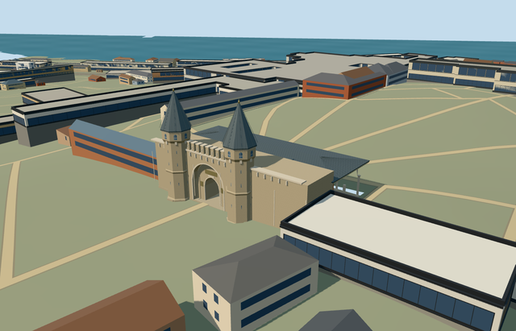

# gate_of_salutation_topkapi_palace — Gate of Salutation, Topkapi Palace

Reviewed2026-10-21. **Individual member complete to the medium-fi visualization standard. Topkapi Palace remains incomplete:1/18 required members.**

## Appearance

Inspected all48 current source/shared/medium-fi/native views during one continuous author/build/inspect/fix pass. Paired octagonal towers, steep lead spires/finials, upper arched slots and lower slits, recessed outer opening and genuinely open smaller gate passage, crenellations/corbels, occupied sloping paving and rear red-brick elevation under an open pointed arcade/lead hip roof/timber soffit. Nine front columns and eight working bays are explicit picture-led approximations. Darkened lead and warmed the rear brick tint after inspecting the first views. Separate palace members/native neighbours remain context; no copied inscriptions/tughra/banner or ceiling art, visitors, security equipment or furnished guard rooms.

## Shared surfaces and browser budgets

Seven existing shared256px graphs: stone_sandstone_raw, stone_limestone_raw, brick, metal_standing_seam, window_grid, wood_plain and metal_bronze_cast. Eight surface roles merge into seven near draws/one skyline draw. No new graph/private atlas/embedded images. Each graph read once; vertex tints distinguish warm rear brick and dark lead while sharing the same texture library. Separate POSITION/NORMAL streams and equal CPU/GPU accounting. Shared opaque glazing approximates reflections.

| Level | Triangles | Bytes | Draws |
| --- | ---: | ---: | ---: |
| skyline | 878 | 80648 | 1 |
| district | 2617 | 253692 | 7 |
| street | 4623 | 436708 | 7 |
| closeup | 6255 | 589908 | 7 |

Four authored levels878/2617/4623/6255triangles; initial skyline plus district334340bytes. Skyline simplifies shaft bands/column capitals while preserving both spires, crenels, real passage, canopy/column rhythm and occupied floor. District adds tower apertures/arcade profiles; street adds frames/arrow slots/beam detail; closeup adds finer arch profiles/corbels/lead seams. Geometry/download/draw/layout budgets pass. Physical ordinary-laptop/phone/tablet/dense-city timings remain pending.

## Native placement

Individual Q134728609/Babusselam and OSM way335402649, named Gate of Salutation in the standard20261020 PMTiles. Parent footprint has the two rounded southern tower projections and long courtyard canopy. Internal+X follows the front wall southeast; internal+Z faces the First Courtyard southwest, with the canopy on-Z facing the Second Courtyard. World heading0/native east-south; signed internal axis0.47801027048290257rad. Anchor[28.98323580622673,41.01140314217439]. All other17 principal palace members, exterior walls/gardens/courts, native paths and independent buildings remain separate. Original standard PMTiles/Mapzen terrain retained. Existing front path control internal[-3.9,25] supplies nativeY0; rear control[-3.9,-20] establishes only the occupied paving slope. Rigid towers/walls/roof stay vertical/level; source paving and individual column feet meet the reconstructed slope, with foundations reaching original boundary minima. Terrain opening stays inside the occupied parent floor, including the covered arcade; the true gate passage stays open. No precinct-wide slab or terrain flattening. Native terrain, ownership and load/unload were inspected2026-10-21. Approximate exterior fit accepted; exact thresholds and host terrain accuracy remain outside scope. Only named Salutation Gate OSM way335402649/native parent35184707491481 replaced. All471 independent resident records of472 and600 wider records of601 retained. Five actual PMTiles13/14/15 cases pass. Original201x201/6m samples, paths and3400960.530898103square metres native water unchanged. Occupied paving seals the tightly bounded parent terrain opening; true gate/arcade passages remain clear. Failure keeps472 originals; all LOD unloads restore terrain/water/zero live model geometry. Visual exterior fit accepted at the actual named parent and facing between First/Second Courtyards. Approximate internal signed axis/facade bearing uncertainty10degrees; exact historical thresholds, optical properties, height datum and accessible routes are not certified. The shared placement view uses a flat control fixture; native evidence is the separate original PMTiles scene.

## Scope and limits

Two ordinary exterior pictures actually viewed: front2015/second-court rear2023. Standard PMTiles supplies the particular parent/tower projections/canopy footprint and paths. Map footprint has no qualified architectural height. Two actually viewed2015/2023 photos support working tower shafts16.3m/lead tips25.2m, main wall11.9m/crenels13.98m, open portal spring4m/rise2.5m/clear width4.4m, outer recess width9.3m, courtyard colonnade spring6.15m/pointed rise3m/roof up to11.15m. Finial/window/corbel/bay counts and exact profiles are visualization approximations; no fine inscriptions, banner art or ceiling paintings copied. Eight canopy bays/nine front columns are a working picture-led rhythm. Source floor follows a modest1.6158746697761475m rise over45m from the two standard map ground controls, not surveyed thresholds or accessible-route certification. Warm stone, muted red brick and dark lead match the medium-fi palette. Fine wall/ceiling art is replaced by neutral original geometric bands/panels. Topkapi Palace is an18-member collection; completion of this gate does not complete the palace.

## Selected checks

Six Khronos files: zero errors/warnings.343 actual mesh/contact probes;48 inspected frames;5 actual native map-level cases. Selected source/import/placement/strict medium-fi/scene/sim30/lint checks pass.10 focused collection-registration tests pass. Sim30 sha256:1656e6b3188bd7cb3337f025352e1ddabfa99caa9c1c418763eff812a7392907.

Source sha256:531f1f4b806f391653269bec502d96e6abf7647823f7a0bf395f5225c79ecdfe

Runtime sha256:92bca0aacb504f346d048aeb42dd68f499eb1800bdda2573f7f14568841bb00d

Input sha256:0a52b9af3b571a54e4fd83b157c6a072d5bd3e725554b55c9d5191a7ea98b044

Rebuild: node packages/worldgen/scripts/generate-additional-landmarks.mjs --ids=gate_of_salutation_topkapi_palace; node packages/worldgen/scripts/import-structure-models.mjs --ids=gate_of_salutation_topkapi_palace; node packages/tooling/scripts/generate-landmark-lods.mjs --ids=gate_of_salutation_topkapi_palace --force.

## Ordinary picture references

https://commons.wikimedia.org/wiki/File:Topkap%C4%B1_Palace_gate.JPG — Mattias Hill; 2015-05-17; CC-BY-SA-4.0. Viewed only; no copied pixels.

https://commons.wikimedia.org/wiki/File:Gate_of_Salutation-Second_Courtyard_(Topkap%C4%B1_Palace).jpg — Yair Haklai; 2023-04-16; CC-BY-SA-4.0. Viewed only; no copied pixels.
