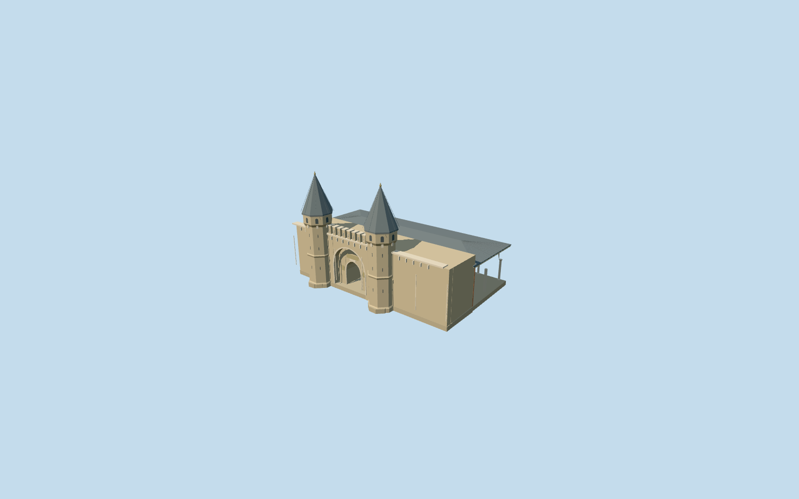

# Gate of Salutation, Topkapi Palace

Gate of Salutation (Babusselam) only, first of18 explicitly required Topkapi Palace assets. Specific twin octagonal stone towers/lead spires/finials and upper arched slots/arrow slits, recessed central arch with a genuinely open smaller through-passage, crenellated parapet/corbels, red-brick courtyard elevation and broad low lead-roof canopy on slender columns/pointed arcades. Gently rising occupied paving follows the existing front/rear standard-ground controls. No composite palace, copied calligraphy/tughra/banner artwork, private texture atlas, furnished guard rooms, visitors or movable security equipment.

## Evidence and reconstruction

Published dimensions and reconstructed details are separated in spec.json. Primary references:

- [Reference](https://commons.wikimedia.org/wiki/File:Topkap%C4%B1_Palace_gate.JPG)
- [Reference](https://commons.wikimedia.org/wiki/File:Gate_of_Salutation-Second_Courtyard_(Topkap%C4%B1_Palace).jpg)

Gate of Salutation (Babusselam) only, first of18 explicitly required Topkapi Palace assets. Specific twin octagonal stone towers/lead spires/finials and upper arched slots/arrow slits, recessed central arch with a genuinely open smaller through-passage, crenellated parapet/corbels, red-brick courtyard elevation and broad low lead-roof canopy on slender columns/pointed arcades. Gently rising occupied paving follows the existing front/rear standard-ground controls. No composite palace, copied calligraphy/tughra/banner artwork, private texture atlas, furnished guard rooms, visitors or movable security equipment.

## Model and axes

6,255 triangles; 18,765 vertices; 7 material groups; 754,968 bytes. Native bounds: -25.351, -0.665, -21.334 to 24.607, 25.200, 20.841. Source hash: `sha256:531f1f4b806f391653269bec502d96e6abf7647823f7a0bf395f5225c79ecdfe`.

{"x":"east","y":"up","z":"south"}

The geographic proposal uses exact-QID OpenStreetMap evidence. Map-derived orientation and estimated architectural details require real-site visual review; preview eligibility is distinct from geographic/fidelity approval. Map attribution: © OpenStreetMap contributors, ODbL-1.0.

## Reproduce

Run `node packages/worldgen/scripts/generate-additional-landmarks.mjs --ids=gate_of_salutation_topkapi_palace` (or add `--check`). The generator preserves manually edited masters by checking their baseline hashes. Import through the standard authored-model workflow with optimization disabled; then capture all QA cameras, including shared-surface views.

## Pending work

- Gate of Salutation (Babusselam) only, first of18 explicitly required Topkapi Palace assets. Specific twin octagonal stone towers/lead spires/finials and upper arched slots/arrow slits, recessed central arch with a genuinely open smaller through-passage, crenellated parapet/corbels, red-brick courtyard elevation and broad low lead-roof canopy on slender columns/pointed arcades. Gently rising occupied paving follows the existing front/rear standard-ground controls. No composite palace, copied calligraphy/tughra/banner artwork, private texture atlas, furnished guard rooms, visitors or movable security equipment.
- Individual Q134728609/Babusselam and OSM way335402649, named Gate of Salutation in the standard20261020 PMTiles. Parent footprint has the two rounded southern tower projections and long courtyard canopy. Internal+X follows the front wall southeast; internal+Z faces the First Courtyard southwest, with the canopy on-Z facing the Second Courtyard. World heading0/native east-south; signed internal axis0.47801027048290257rad. Anchor[28.98323580622673,41.01140314217439]. All other17 principal palace members, exterior walls/gardens/courts, native paths and independent buildings remain separate.
- Map footprint has no qualified architectural height. Two actually viewed2015/2023 photos support working tower shafts16.3m/lead tips25.2m, main wall11.9m/crenels13.98m, open portal spring4m/rise2.5m/clear width4.4m, outer recess width9.3m, courtyard colonnade spring6.15m/pointed rise3m/roof up to11.15m. Finial/window/corbel/bay counts and exact profiles are visualization approximations; no fine inscriptions, banner art or ceiling paintings copied. Eight canopy bays/nine front columns are a working picture-led rhythm. Source floor follows a modest1.6158746697761475m rise over45m from the two standard map ground controls, not surveyed thresholds or accessible-route certification.
- Original standard PMTiles/Mapzen terrain retained. Existing front path control internal[-3.9,25] supplies nativeY0; rear control[-3.9,-20] establishes only the occupied paving slope. Rigid towers/walls/roof stay vertical/level; source paving and individual column feet meet the reconstructed slope, with foundations reaching original boundary minima. Terrain opening stays inside the occupied parent floor, including the covered arcade; the true gate passage stays open. No precinct-wide slab or terrain flattening. Native terrain, ownership and load/unload were inspected2026-10-21. Approximate exterior fit accepted; exact thresholds and host terrain accuracy remain outside scope.

This bundle follows the medium-fi standard. Medium-fi appearance and geographic fit are reviewed separately. Hash-bound visual acceptance is recorded separately after capture inspection.
