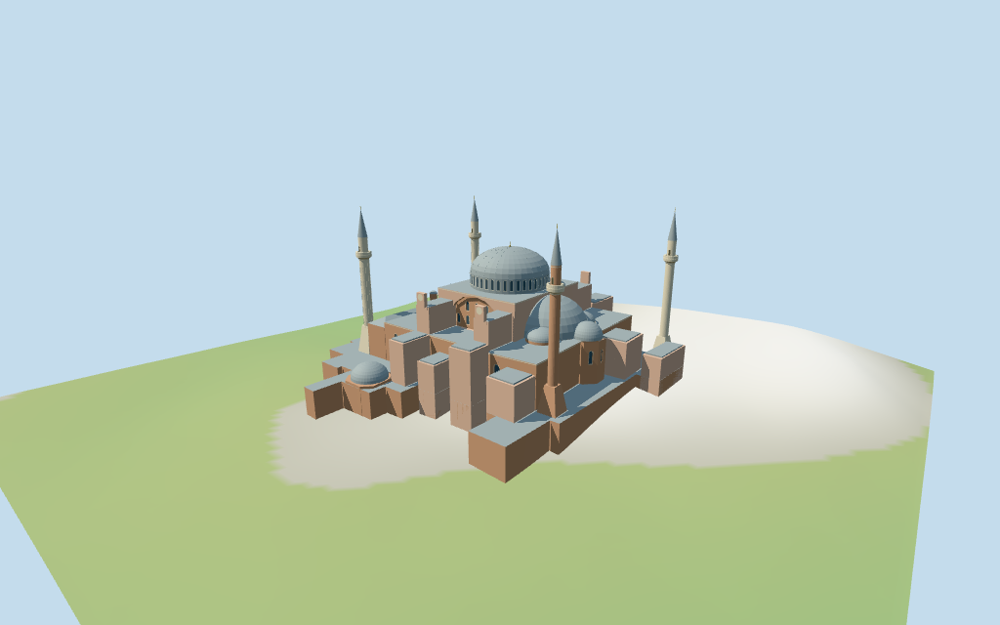

# Hagia Sophia — Istanbul

Individual medium-fi Istanbul Hagia Sophia:shallow lead-grey central dome over dark arched-window drum,two cascading semidomes/four exedrae and polygonal apse;large recessed red tympana between pink/buff piers,stepped lower roofs/narthex/buttresses;four mapped minarets with two broad pale western shafts,a slender pale northeast shaft and red southeast shaft,balconies/pointed metal cones/finials. Five existing shared256² graphs,seven merged groups and four browser LODs. Exact current whole/parts retained;map heights nominal,fine profiles and exact terrain/site joins estimated or unverified. Separate south tombs excluded.

## Evidence and reconstruction

Published dimensions and reconstructed details are separated in spec.json. Primary references:

- [Reference](https://commons.wikimedia.org/wiki/File:Hagia_Sophia_2013-03-18h.jpg)
- [Reference](https://commons.wikimedia.org/wiki/File:Hagia_Sophia_2013-03-18e.jpg)
- [Reference](https://commons.wikimedia.org/wiki/File:Agia_Sofia_seen_from_Northwest_51.jpg)
- [Reference](https://commons.wikimedia.org/wiki/File:Hagia_Sophia_Mars_2013.jpg)

Five existing shared256² lime plaster,brick,raw limestone,painted metal and plain wood graphs;local blue-grey glazing/muted gold;seven groups. Shared metal abstracts lead roofs/cones. Linear tints,metric UVs,flat normals;no embedded images,unique facade photographs,bespoke textures or baked lighting.

## Model and axes

29,679 triangles; 89,037 vertices; 7 material groups; 3,565,576 bytes. Native bounds: -67.108, -8.646, -65.989 to 67.125, 72.500, 66.085. Source hash: `sha256:99c2be61f8d3ee24695f2cd26754c925b20dccd0885ebb5f6e527119a0e687bf`.

{"x":"east-southeast toward polygonal apse","y":"up","z":"south-southwest toward separate tombs and Sultanahmet Park"}

Standard viewer DEM datum44.669242m;selected perimeter-8.30 to4.09m relative to it. Floor0.5m;adaptive masonry footings crossY=0 and extend below retained samples. Coarse urban terrain is not used to infer precise courtyards,paths,entry steps or curbs. Exact road/court/threshold/step/base contact,altitude and walking remain unverified. No flattening,cutout or road replacement.

## Reproduce

Run `node packages/worldgen/scripts/generate-additional-landmarks.mjs --ids=hagia_sophia_istanbul` (or add `--check`). The generator preserves manually edited masters by checking their baseline hashes. Import through the standard authored-model workflow with optimization disabled; then capture all QA cameras, including shared-surface views.

## Pending work

- Retained way/109862851 and Q12506 identify Hagia Sophia /Ayasofya in Istanbul,not the separate Q1568660 Thessaloniki Hagia Sophia assetN0361. Current standard viewer PMTiles whole35184481951683 and48 selected main-complex parts retain487 raw outline points/properties;earlier exact-QID whole/multilingual tags and same-ID named POI retained. Anchor[28.979951797,41.008480724] and heading−0.588897917451rad unchanged;no horizontal rescale. Native+X east-southeast polygonal apse,−X west-northwest narthex,+Z south-southwest toward tombs and Sultanahmet Park. Four matching exterior pictures resolve signed facing,approximate3°. Three separate domed tombs south of the whole,other town buildings,courtyards,roads,trees and park remain host content.
- Current map nominal controls:main body25m,narthex25m/exonarthex9m,west ribs12m;large east/west piers36m;upper cross41m;dome support min_height40/height46m;main dome min_height40/height56m;two semidomes min_height23/height39m;four smaller exedrae30m,east apse31m,two west roof turrets min_height31/height34m;four minarets72m with nominal base envelopes21m/31m and three balcony bands min_height50/height52m. Retained Wikidata facts55m height,73m width,82m length have no linked reference URLs and are consistency hints,not surveyed datum. Estimated partitions above floor0.5m:main drum40–46m/shallow metal cap46–56m/finial58m;semidome drums23–25m/caps25–39m;small exedrae24–26m/caps30m;apse wall25m/cap31m. Minaret plinths taper through18–20m into shafts to50m,balconies50–52m,necks59m,metal cones70.5m/finials72m. Base envelopes do not imply full rectangular masonry to31m. Arches,pier caps,bays,roof steps,balcony/finial/fluting/portal details and untagged buttress heights are picture estimates;exact construction and ground joins unverified.
- Standard viewer DEM datum44.669242m;selected perimeter-8.30 to4.09m relative to it. Floor0.5m;adaptive masonry footings crossY=0 and extend below retained samples. Coarse urban terrain is not used to infer precise courtyards,paths,entry steps or curbs. Exact road/court/threshold/step/base contact,altitude and walking remain unverified. No flattening,cutout or road replacement.
- Individual medium-fi exterior from four inspected matching pictures and standard viewer PMTiles/DEM. Exact current whole/parts retained;nominal height tags and unsourced Wikidata dimension hints do not establish surveyed heights. Dome curvature,window/pier/tympanum/narthex/buttress/apse/exedra/minaret/balcony/fluting/finial profiles are estimates or abstractions. Faithful Byzantine/Ottoman carving,masonry chronology,inscriptions,stained-glass artwork,interiors,engineering,current restoration finish,hidden joins and exact court/road/threshold/step/base contact remain simplified,excluded or unverified. Glazing/doors are recessed fields;balconies are simplified solid parapets,with no traversal or open-interior claim. Three separately mapped domed tombs to south,park/courtyards/roads,trees and other town buildings remain host content. Mediterranean neighbors are synthetic;physical phone/laptop timing unverified.
- Skyline uses six-sided principal caps,conical small roofs,two outer west ribs and simplified minaret necks;the thin central finial is omitted. Skyline retains main shallow dome,two semidomes,four small exedrae,stepped roofs/narthex/buttresses and four spatially distinct minarets with red/pale shafts and pointed caps. District adds shared surfaces,coarse drum/tympanum/narthex/body windows,giant arch recesses,west arched field,pier end caps and balcony bands. Street adds fuller window rhythm,mullions,main dome ribs,minaret fluting/door and solid balcony parapets;close-up/master refine curves/ribs.

This bundle follows the medium-fi standard. Medium-fi appearance and geographic fit are reviewed separately. Hash-bound visual acceptance is recorded separately after capture inspection.

## Additional geographic data

©OpenStreetMap contributors;Protomaps;Mapzen/USGS terrain tiles.
