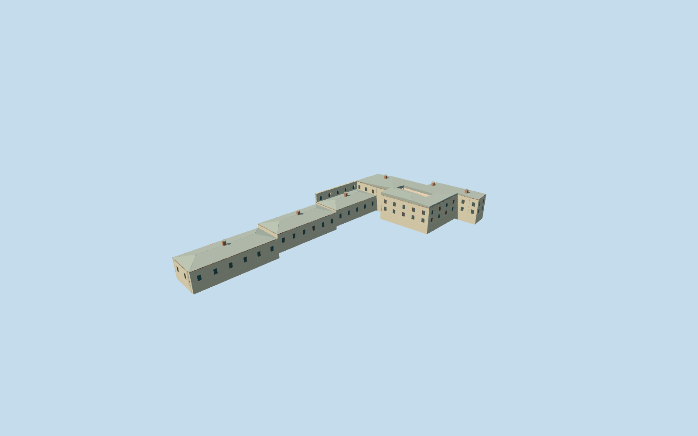

# Halberdiers Quarters, Topkapi Palace

Named L-shaped Halberdiers quarters/service range on way32396154. Retain its exact notched exterior and open court outside the L, reconstruct a narrow head court, pale stone outer elevations, selected pale/salmon plaster inner elevations, lead hips, brick/cowl chimneys, projecting upper story with timber corbels, actual entrances and stair approach. No Tower of Justice, independent colonnade, private inscriptions, museum furniture or visitors. The small head courtyard is a picture-led reconstruction within the mapped exterior, not an OSM courtyard survey. The long service range uses three conservative floor steps from the retained grade rather than one oversized plinth. Detailed internal room inventory remains approximate.

## Evidence and reconstruction

Published dimensions and reconstructed details are separated in spec.json. Primary references:

- [Reference](https://commons.wikimedia.org/wiki/File:Topkap%C4%B1_Exterior_view_of_Quarters_of_the_Halberdiers_with_Tresses2012_01_6351.jpg)
- [Reference](https://commons.wikimedia.org/wiki/File:20180115_Topkapi_8062_(25290665087).jpg)
- [Reference](https://commons.wikimedia.org/wiki/File:20180115_Topkapi_8059_(25290669627).jpg)

Named L-shaped Halberdiers quarters/service range on way32396154. Retain its exact notched exterior and open court outside the L, reconstruct a narrow head court, pale stone outer elevations, selected pale/salmon plaster inner elevations, lead hips, brick/cowl chimneys, projecting upper story with timber corbels, actual entrances and stair approach. No Tower of Justice, independent colonnade, private inscriptions, museum furniture or visitors. The small head courtyard is a picture-led reconstruction within the mapped exterior, not an OSM courtyard survey. The long service range uses three conservative floor steps from the retained grade rather than one oversized plinth. Detailed internal room inventory remains approximate.

## Model and axes

28,320 triangles; 77,630 vertices; 8 material groups; 3,139,344 bytes. Native bounds: -54.913, -6.349, -47.375 to 54.932, 11.528, 47.313. Source hash: `sha256:2785087df10e8289982ae0a133b32b97c478655196afcdb2e1066b15af3cc213`.

{"x":"east","y":"up","z":"south"}

The geographic proposal uses exact-QID OpenStreetMap evidence. Map-derived orientation and estimated architectural details require real-site visual review; preview eligibility is distinct from geographic/fidelity approval. Map attribution: © OpenStreetMap contributors, ODbL-1.0.

## Reproduce

Run `node packages/worldgen/scripts/generate-additional-landmarks.mjs --ids=halberdiers_quarters_topkapi_palace` (or add `--check`). The generator preserves manually edited masters by checking their baseline hashes. Import through the standard authored-model workflow with optimization disabled; then capture all QA cameras, including shared-surface views.

## Pending work

- Named L-shaped Halberdiers quarters/service range on way32396154. Retain its exact notched exterior and open court outside the L, reconstruct a narrow head court, pale stone outer elevations, selected pale/salmon plaster inner elevations, lead hips, brick/cowl chimneys, projecting upper story with timber corbels, actual entrances and stair approach. No Tower of Justice, independent colonnade, private inscriptions, museum furniture or visitors. The small head courtyard is a picture-led reconstruction within the mapped exterior, not an OSM courtyard survey. The long service range uses three conservative floor steps from the retained grade rather than one oversized plinth. Detailed internal room inventory remains approximate.
- Topkapi Q170495 member way32396154/native35184404484986; current OSM page explicitly names Zülüflü Baltacılar Koğuşu and lead roof colour#cbd1cd. Exact original notched L parent retained. Internal+X northeast along the long service range; internal+Z southeast toward the external court. Independent Council Hall, Tower of Justice and colonnade remain outside this model.
- Picture-led single-storey service range eaves5.6m and two-storey court head eaves7.6m above each declared floor, with shallow lead hips. Three service floor levels follow existing grade and are reconstruction controls, not surveyed historic steps. Narrow court5.5x16m, timber corbel positions and chimney inventory are representative; hidden roofs/rooms and architectural heights remain approximate.
- Existing standard Protomaps/Mapzen extract and original161x161/6m grid retained. Reference anchor lies outside all573 native records. Each service component uses a local floor datum; head court retains original host ground, with one bounded occupied entry stair. Cutouts follow only actual modeled rooms/stair. Coarse grade can expose foundations or bury low thresholds; inspect native views before activating. No bespoke terrain or precinct flattening.

This bundle follows the medium-fi standard. Medium-fi appearance and geographic fit are reviewed separately. Hash-bound visual acceptance is recorded separately after capture inspection.
