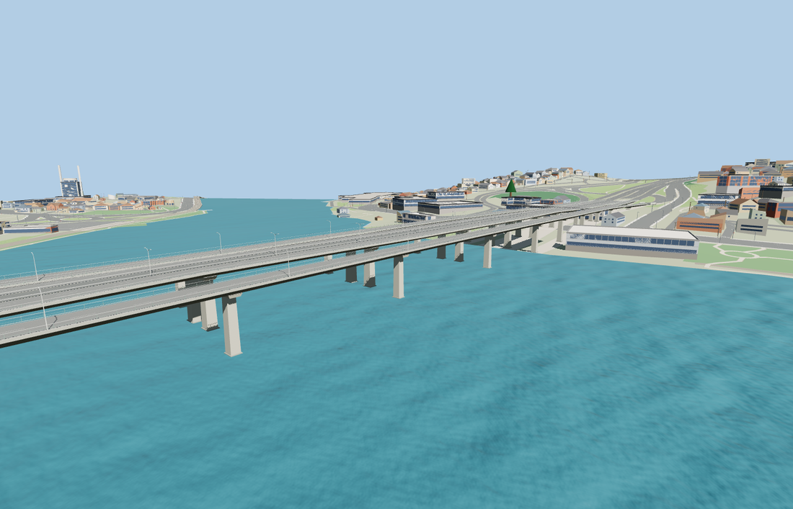

# Haliç Bridge

Three independently placed decks follow the mapped crossing between Ayvansaray and Halıcıoğlu. The central deck carries the two divided Metrobus lanes and the main carriageways. The side decks include their curved approaches and remain separate over the Golden Horn.

The three source masters total 50,240 triangles and rebuild byte for byte. Skyline and district across all three decks total 749,108 bytes. Eighteen GLBs validated and 58 current views were inspected. The three material graphs are shared across all decks.

Twelve sampled approach centerline joins per level matched within 0.018 m in the viewer fixture. Six gap probes per level remained open. The viewer retained all 7 checked underpass records and 1,500 nearby building records. The underlying bridge returns if the authored models fail to load.

Deck grades, pier stations and ramp edges are exterior reconstructions. The road and Metrobus footprints follow the attributed relation and standard PMTiles road traces. Native ramp tails and outer lane widths vary with the host data.

Rebuild with `node packages/worldgen/scripts/generate-halic-bridge.mjs`. Append `--check` for exact source bytes. Use `--ids=halic_bridge` to import and review the three members together.
