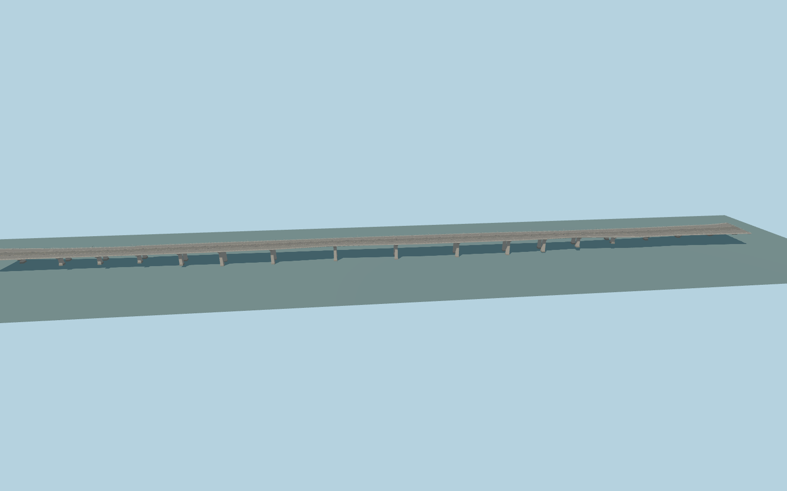

# halic bridge main deck

The broad central motorway deck carries the two separated Metrobus lanes between the general carriageways. The continuous concrete fascias, portal pier caps, divided lanes and double-arm lamps follow the photographed crossing.

The native placement and shared material review appear in the [bridge assembly review](../halic_bridge/QA-REVIEW.md). Skyline and district for this deck total 283,888 bytes.

The deck outline and nearby ramps follow the corresponding member of OSM relation 16512008. PMTiles road traces determine the signed axis and carriageway placement. Vertical grades, concrete pier spacing and below-deck members are exterior reconstructions using ordinary photos and the standard terrain. Lane details represent the photographed configuration. At the approach forks, the host renderer supplies clipped ramp tails and pavement beyond the authored outlines. Their lateral edges depend on the host road widths and grade.
