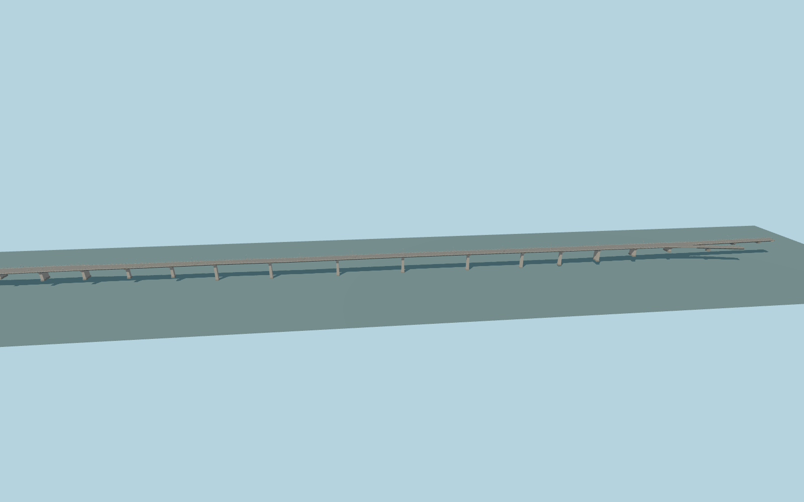

# Haliç Bridge southeast deck

The southeast flanking deck follows its own curved alignment, with slender piers, open railings, traffic lanes and the mapped ramp connections.

Rebuild with `node packages/worldgen/scripts/generate-halic-bridge.mjs`;append `--check` for exact source bytes. Select import/LOD/placement with `--ids=halic_bridge`. Detailed source and four browser tiers are separate ignored GLB outputs.

The deck outline and nearby ramps follow the corresponding member of OSM relation 16512008. PMTiles road traces determine the signed axis and carriageway placement.

Vertical grades, concrete pier spacing and below-deck members are exterior reconstructions using ordinary photos and the standard terrain. Lane details represent the photographed configuration.

At the approach forks, the host renderer supplies clipped ramp tails and pavement beyond the authored outlines. Their lateral edges depend on the host road widths and grade.

Original geometry follows the repository license. The adjacent Haliç Bridge collection holds the map excerpt, terrain, shared recipe and reference observations. Current acceptance is recorded in qa.json.
