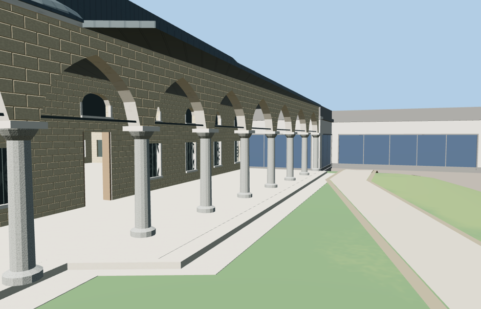

# Has Oda Koğuşu

A nine-bay column arcade follows the irregular dormitory frontage, with shallow lead-colored domes above and a narrow connector at the south end. A two-level stone landing follows the three segments of the arcade edge.

The footprint follows OSM way 103907804. The bounded court grade is 46.00 m. The lower landing meets the rendered grass surface about 12 mm above it at the sampled points.

The fixture retains 96 transportation records, native water and 12 neighboring landmark models. A failed download restores the mapped building. Unload restores ground and land cover and releases the model geometry.

| Detail level | Triangles | Download bytes | Draws |
| --- | ---: | ---: | ---: |
| skyline | 993 | 92,212 | 1 |
| district | 2,965 | 283,892 | 7 |
| street | 11,237 | 997,228 | 8 |
| closeup | 16,297 | 1,438,944 | 8 |

Skyline and district total 376,104 bytes. Six GLBs and 115 placement probes passed. The review covers 57 current renders.

The fitted court level and exterior trim use the retained map, terrain and ordinary reference photos. The arcade recesses are modeled and room interiors are outside the exterior scope.

[Mapped site frame](map-frame.json) · [Terrain fit](site-fit.json) · [QA evidence](qa.json)
