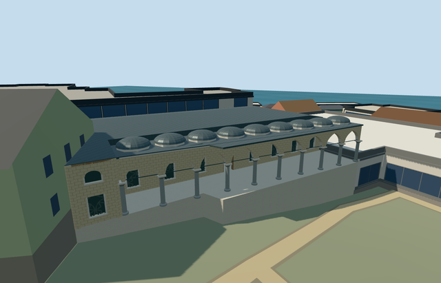

# has_oda_kogusu_topkapi_palace — Has Oda Kogusu, Topkapi Palace

Reviewed2026-10-21. **Source/shared-material/browser LOD review complete; native terrain fit pending. Public placement remains an inactive draft. Do not count this member ready. Topkapi remains10/18 ready.**

## Authored and inspected

Inspected47 current portable/shared/medium-fi/native views during one continuous author/build/inspect/fix pass. Irregular elongated dormitory range, pale walls, recessed rectangular lower windows with shared screens and smaller arched upper panes, open room entrance, grey circular shafts with pale capitals, nine actual open pointed bays, iron ties and shallow lead portico crowns. Preserved the angled southern connector. Corrected a real roof gap over its projecting spur by extending and clipping the hipped roof domain. All ten earlier palace members retain their exact current input/source/runtime pins. Source and flat shared/context views establish model quality; native terrain fit is rejected below.

## Native placement remains unfinished

Declared Topkapi Q170495 OSM member way103907804/native35184475996636. Existing standard PMTiles fixes the full irregular parent and angled southern connector. Internal+X follows the range northeast; internal+Z faces southeast into Third Courtyard. Ordinary courtyard photographs guide the arcade. Has Oda Kogusu is the dormitory, not the adjacent Sacred Relics chamber or the Harem private rooms. Existing standard Protomaps/Mapzen extract and original161x161/6m grid retained. Uncovered court attachment internal[8,19] is outside all573 original building records, verified before authoring. Level floor .18m above highest original boundary sample; bounded protective base follows only the actual mapped parent, leaving the exterior court open. Falling coarse ground may expose foundations; threshold/basement heights remain unverified. No precinct flattening or bespoke terrain. Initial native render exposes several metres of plain protective base along the courtyard arcade. Native elevation fit is not accepted; public placement must remain draft. Geometry/contact and XY ownership checks do not approve this visual fit. Native horizontal ownership/facing and load/disposal checks pass: one named parent removed,258 independent resident buildings of259 and572 wider independent records of573 retained, with original161x161/6m terrain/roads/3400906.0006393427 square metres water. Fourteen overlapping map cases13/14/15 pass, including both detailed parent fragments. Failed loading retains259 originals; every LOD unload restores terrain/water and zero live model geometry. Attachment internal[8,19] is outside all573 original records; native terrain remains there. HOWEVER, the original terrain falls from one end of the range to the other. The level source floor exposes several metres of plain protective base along the arcade, unlike the ordinary courtyard photos. This native visual fit is not approved. Keep the public placement inactive draft; do not count this member ready. No custom terrain or precinct flattening was introduced.

## Shared surfaces and browser levels

Eight existing256px shared graphs: stone_limestone, stone_limestone_raw, stone_marble, stone_granite, metal_standing_seam, metal_painted, wood_plain and metal_rosette_screen. Eight roles merge to eight close draws/seven district draws/one skyline draw. Metric wall/roof quad UVs, linear palette tints and shared opaque metal window backs. Existing screen pattern substitutes for bespoke ironwork. Each requested graph read once. No new graph/private atlas/embedded images. Separate POSITION/NORMAL streams and equal CPU/GPU accounting.

| Level | Triangles | Bytes | Draws |
| --- | ---: | ---: | ---: |
| skyline | 969 | 90,124 | 1 |
| district | 2,941 | 281,792 | 7 |
| street | 11,213 | 995,124 | 8 |
| closeup | 16,273 | 1,436,696 | 8 |

Initial geometry: **371,916bytes**. Four authored levels; exact counts/bytes/draws in the table below and qa.json. Initial geometry371916bytes. Skyline retains the notched mass, open colonnade, low roof crowns and lower-window rhythm. District restores upper windows, capitals and less angular crowns. Street/closeup restore actual recessed windows/opaque two-sided backs, shared screens, small frames, ties and finer arch/crown profiles. Every level meets triangle/draw/download/layout budgets. Synthetic context uses scale1 and ground at the authored occupied floor, so procedural-neighbor views are readable without treating a flat fixture as native-fit evidence. Only context framing changed; all six GLBs stayed byte-identical, with explicit continuity proof for reused geometry/portable/shared/native reports. Physical ordinary-laptop/phone/tablet and dense-city timings remain pending.

## Scope and limitations

Two ordinary exterior photos actually viewed (Mark Ahsmann2013-12-04 and Maksym Kozlenko2013-01-02) plus existing PMTiles. Footprint/angled connector and courtyard-facing axis are map-led. Picture-led eaves5.8m, spring3.25m and shallow portico crowns above the authored occupied floor; nine representative open bays along the mapped straight courtyard leg. Hidden rear windows, the main hipped roof, window/door inventory and exact crown profiles are approximations. No measured architectural heights; native height5 is a coarse map hint. Nine arcade bays and crown count are representative picture-led controls, not a surveyed inventory. Rear elevations, hip roof, inaccessible windows and door position remain approximations. No copied inscriptions/artwork, large Sacred Relics dome, visitors/gardens or furnished museum interior. Agas Mosque and Sacred Relics chambers remain independent native context. Source geometry is authored and reviewed; this palace member remains incomplete because native terrain fit fails.

## Targeted checks

Six current GLBs: zero Khronos errors/warnings;376 actual mesh/contact probes;14 PMTiles overlap cases13/14/15.47 current views actually inspected. Selected source/import/placement draft/strict medium-fi/scene/sim30/lint checks pass. Sim30:164c6e9d540211eedb57d581adfb2c064ee523082538ebaad31c92b5c3ece813. These checks preserve the failed native terrain-fit result.

Rebuild with generate-additional-landmarks.mjs --ids=has_oda_kogusu_topkapi_palace, import-structure-models.mjs --ids=has_oda_kogusu_topkapi_palace and generate-landmark-lods.mjs --ids=has_oda_kogusu_topkapi_palace --force in their existing script directories. Editable map, roof and grade controls live in map-frame.json and pmtiles-fit.json; exact model/input hashes in qa.json. No review-image archive is required to rebuild the GLBs.

## Viewed photographs

- https://commons.wikimedia.org/wiki/File:20131204_Istanbul_057.jpg — Mark Ahsmann; 2013-12-04; CC-BY-SA-3.0. Viewed only; no copied pixels.

- https://commons.wikimedia.org/wiki/File:2013-01-02_Topkap%C4%B1_Palace_68.jpg — Maksym Kozlenko; 2013-01-02; CC-BY-SA-4.0. Viewed only; no copied pixels.
