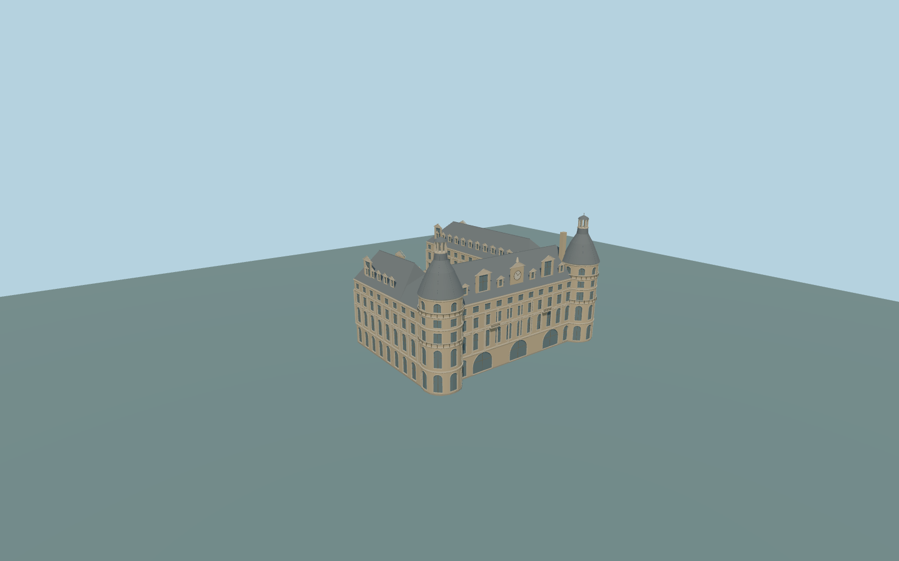

# Haydarpaşa railway station

Complete permanent historic U-shaped passenger building, including the whole long southeast and shorter northwest wings, open rail-side court, twin cylindrical seaward corner towers with steep slate roofs and open lanterns, main steep roof and dormers, shaped central clock gable, repeated pilasters/cornices, tall arched windows and closed glazed ground doors. Original medium-fi relief and hidden courtyard/rear opening inventory. Exclude temporary restoration scaffolding, large roof railway logo, copied lettering/sculpture, quay/rocks/water, seaward kiosk, separate rear buildings, rail infrastructure and navigable interior.

Rebuild: `node packages/worldgen/scripts/generate-haydarpasa-railway-station.mjs`;append `--check` for exact source bytes. Select import/LOD/placement with `--ids=haydarpasa_railway_station`. Detailed source and four browser tiers are separate ignored GLB outputs.

Complete permanent historic U-shaped passenger building, including the whole long southeast and shorter northwest wings, open rail-side court, twin cylindrical seaward corner towers with steep slate roofs and open lanterns, main steep roof and dormers, shaped central clock gable, repeated pilasters/cornices, tall arched windows and closed glazed ground doors. Original medium-fi relief and hidden courtyard/rear opening inventory. Exclude temporary restoration scaffolding, large roof railway logo, copied lettering/sculpture, quay/rocks/water, seaward kiosk, separate rear buildings, rail infrastructure and navigable interior.

Current U-shaped parent bounds are about72.46m across the seaward front and84.74m in total depth, with a long southeast and shorter northwest return. Native7.25m height and retained8levels are preserved as conflicting map facts. Ordinary front/side picture proportions supply approximate source23.5m cornices,33m main roof ridges,34.1m clock-gable finial,28.5m tower shafts,40m tower roof necks,44.3m lantern caps/45m antenna tips and38.4m chimney cap. These are approximate visualization controls,not surveyed dimensions. One common unmodified host sample outside the seaward facade [0,43.5], 2.88518125m,suppliesY=0;occupied floor+.35m/support-3m. Exact quay,entrance,court and historic floor grades remain approximate.

One complete historic front picture and one 2024 complete front/long-side picture during restoration, both actually inspected. Permanent roofs and towers are visible. Unseen court/rear opening inventory and exact dimensions remain approximate; no further reference research needed. Permanent architectural exterior only; temporary2024 restoration scaffolding, banners, fences and roof railway logo are excluded. Original medium-fi pediments,clock and simple relief; no copied lettering,sculptural likeness or navigable interior. Exact native terrain contact requires final rendered inspection. Physical-device timings and numerical LOD errors remain unmeasured.

Six existing shared256px limestone,granite,slate,painted-metal,wood andpunched-window graphs;five groups in district/street andsix in closeup/master. Metric UVs andlinear colors,no private orembedded images. Skyline keeps theUplan/open court,twin roof/lantern silhouettes andclock withflat window bands. District addsindividual window patches,dormers andbands. Street retainsfront andtower recesses,shallow side-window frames,pilasters andrail geometry. Close-up addsall window recesses,wood mullions,solid pediment profiles andfiner curves. Master preservesfiner cylindrical walls/roof curves andhidden tower inventory separately.

Original geometry:repository license. Map:© OpenStreetMap contributors,ODbL-1.0;Protomaps. Standard terrain:terrain-grid.json. Ordinary pictures stay local and are not redistributed or used as textures. Current acceptance:qa.json.
