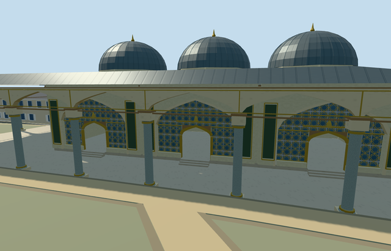

# imperial_council_hall_topkapi_palace — Imperial Council Hall, Topkapı Palace

Reviewed 2026-10-21. **Individual member complete to Molen’s medium-fi standard. Topkapı Palace remains incomplete: 4 of 18 required members.**



## Built and inspected

Cream Council Hall, compact lead-domed bays, broad hipped canopy, open courtyard and southwest-return porticos, pale mottled columns with stepped capitals/gold collars, recessed pointed window screens and open lower doors into enclosed halls. Raised room floors and three small steps remain visible in closer levels. Original neutral panels and shared rosette screening replace bespoke paintings, inscriptions and exact lattice artwork; furnished interiors and visitors are excluded.

The first native render exposed a separately mapped attached portico roof hiding the façade. Its actual L-shaped footprint is now included in the model and replacement mask. The independent Treasury, Tower of Justice and Harem remain intact. Three ordinary exterior pictures and the existing PMTiles informed the same continuous author/build/inspect/fix pass. All 48 final source, shared-material, medium-fi and native views were inspected.

## Shared surfaces and browser budgets

Eight existing 256² graphs serve ten roles: lime plaster, marble, standing-seam metal, timber, bronze, granite, window grid and rosette screen. No new graph, private atlas or embedded images. The runtime LOD screens use explicit metric UVs for a finer shared motif; the pattern is an approximation of the actual lattice. Each requested graph is read once. POSITION and NORMAL use separate buffers; CPU/GPU geometry accounting agrees.

| Level | Triangles | Bytes | Draws |
| --- | ---: | ---: | ---: |
| skyline | 961 | 96,264 | 1 |
| district | 3,109 | 308,104 | 8 |
| street | 10,267 | 1,015,832 | 8 |
| closeup | 16,015 | 1,591,172 | 8 |

Initial skyline plus district: **404,368 bytes**. Physical laptop, phone/tablet and dense-city measurements remain pending.

## Placement and limits

Primary hall: OSM way103907772/native35184475996604. Attached layer1 portico: way335402671/native35184707491503. Both belong to this physical member within Topkapı site Q170495; no separate unverified Wikidata ID is invented. Native +X is east, +Z south, heading 0. The long façade runs north-northeast and faces the Second Courtyard east-southeast, with approximately 10° picture-led bearing uncertainty.

Approximate native exterior fit is accepted. The existing courtyard control internal[0,10] fixes Y0 independently of roof samples. Covered paving remains level, room floors sit 0.3 m above it, and foundations reach the original perimeter low. Only the occupied hall/portico ground opens. All 257 independent resident records of 259 and 571 wider independent records of 573 remain unchanged, including Treasury and Tower of Justice. Original 161 × 161 / 6 m terrain samples, roads and 3,400,906.0006393427 m² of native water are preserved. Failed loading keeps all 259 original records; every LOD unload restores ground/water and frees all model geometry.

Heights, bay inventory, fine decoration and inaccessible roof geometry are explicit approximations. Trees obscure portions of the actual roof; the three-bay dome reconstruction is footprint-led and its full room/dome inventory is not certified. This is a recognizable visualization model, with no claim of surveyed historical levels, precise thresholds or accessibility.

## Verification

- Six GLBs: zero Khronos errors/warnings; 239 actual geometry/contact probes.
- Ten actual overlapping PMTiles cases at levels 13, 14 and 15.
- Targeted source rebuild, import/hash, placement, strict medium-fi, scene validation, 30-tick simulation and lint pass.
- Sim30: `sha256:9ce618854744e4695e1735945eb152f51b19d6c61ff403a414266b7c6c2933f4`.

Current source/runtime/input hashes and inspected-frame bindings are in [qa.json](qa.json).

## Rebuild

```sh
node packages/worldgen/scripts/generate-additional-landmarks.mjs --ids=imperial_council_hall_topkapi_palace
node packages/worldgen/scripts/import-structure-models.mjs --ids=imperial_council_hall_topkapi_palace
node packages/tooling/scripts/generate-landmark-lods.mjs --ids=imperial_council_hall_topkapi_palace --force
```

## Ordinary picture references

- [2023-04-16 exterior](https://commons.wikimedia.org/wiki/File:Exterior_of_the_Imperial_Council_(Topkap%C4%B1_Palace)-.jpg): Yair Haklai, CC-BY-SA-4.0.
- [2013-06-15 exterior](https://commons.wikimedia.org/wiki/File:Turkey-03432_-_Kubbealti_Building_(11313996004).jpg): Dennis G. Jarvis, CC-BY-SA-2.0.
- [2006-05-27 exterior](https://commons.wikimedia.org/wiki/File:4133_Istanbul_-_Topkapi_-_Divano_(Kubbealti)_-_Foto_G._Dall%27Orto_27-5-2006.jpg): Giovanni Dall'Orto, Attribution-only (Commons).

Pictures were viewed only; no image pixels, paintings or calligraphy were copied.
