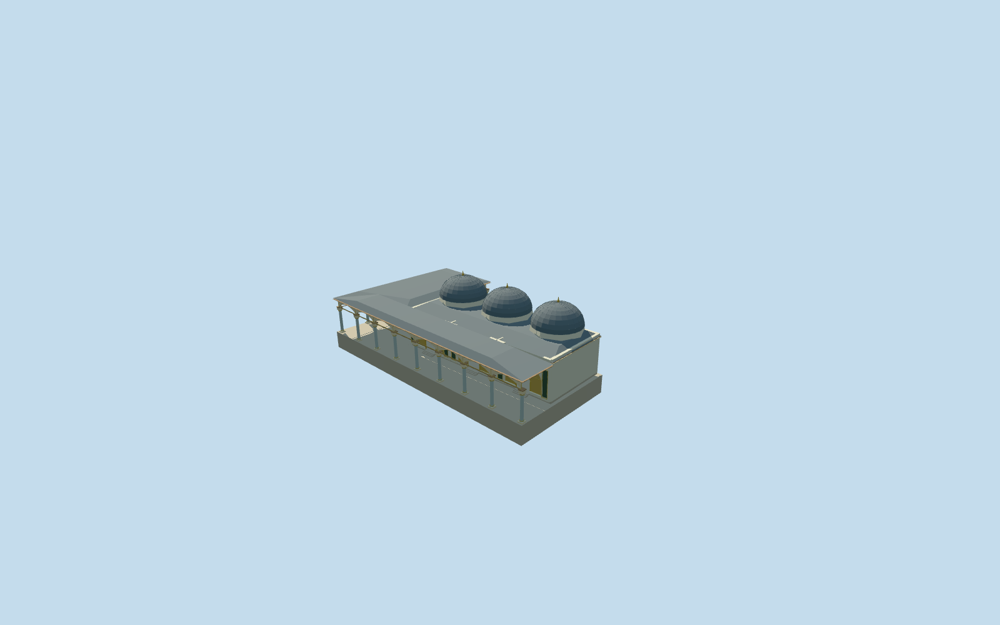

# Imperial Council Hall, Topkapi Palace

Imperial Council Hall (Kubbealti) with attached L-shaped portico, named OSM way103907772 and roof way335402671, fourth authored member of18 Topkapi Palace structures. Low cream hall, broad hipped lead portico cap, working courtyard and southwest-return pointed arcades, pale marble shafts with stepped capitals/gold collars, recessed large pointed gold-toned window screens and lower open arched doors into enclosed halls. Three compact domed bays are an explicit footprint-led roof reconstruction; exact inaccessible dome/room inventory and profiles remain approximate. Shared neutral rosette screening replaces bespoke lattice artwork. Tower of Justice, adjacent Outer Treasury, Harem and other independent buildings remain host context. No copied painted ceiling scenes, inscriptions/tughra, furniture or visitors.

## Evidence and reconstruction

Published dimensions and reconstructed details are separated in spec.json. Primary references:

- [Reference](https://commons.wikimedia.org/wiki/File:Exterior_of_the_Imperial_Council_(Topkap%C4%B1_Palace)-.jpg)
- [Reference](https://commons.wikimedia.org/wiki/File:Turkey-03432_-_Kubbealti_Building_(11313996004).jpg)
- [Reference](https://commons.wikimedia.org/wiki/File:4133_Istanbul_-_Topkapi_-_Divano_(Kubbealti)_-_Foto_G._Dall%27Orto_27-5-2006.jpg)

Imperial Council Hall (Kubbealti) with attached L-shaped portico, named OSM way103907772 and roof way335402671, fourth authored member of18 Topkapi Palace structures. Low cream hall, broad hipped lead portico cap, working courtyard and southwest-return pointed arcades, pale marble shafts with stepped capitals/gold collars, recessed large pointed gold-toned window screens and lower open arched doors into enclosed halls. Three compact domed bays are an explicit footprint-led roof reconstruction; exact inaccessible dome/room inventory and profiles remain approximate. Shared neutral rosette screening replaces bespoke lattice artwork. Tower of Justice, adjacent Outer Treasury, Harem and other independent buildings remain host context. No copied painted ceiling scenes, inscriptions/tughra, furniture or visitors.

## Model and axes

16,015 triangles; 47,787 vertices; 8 material groups; 1,917,360 bytes. Native bounds: -22.195, -2.698, -14.532 to 15.884, 10.950, 27.599. Source hash: `sha256:2225c439d3cdabe44790b10d7abe72d7a361f9ea71719515fac54a4878a232ad`.

{"x":"east","y":"up","z":"south"}

The geographic proposal uses exact-QID OpenStreetMap evidence. Map-derived orientation and estimated architectural details require real-site visual review; preview eligibility is distinct from geographic/fidelity approval. Map attribution: © OpenStreetMap contributors, ODbL-1.0.

## Reproduce

Run `node packages/worldgen/scripts/generate-additional-landmarks.mjs --ids=imperial_council_hall_topkapi_palace` (or add `--check`). The generator preserves manually edited masters by checking their baseline hashes. Import through the standard authored-model workflow with optimization disabled; then capture all QA cameras, including shared-surface views.

## Pending work

- Imperial Council Hall (Kubbealti) with attached L-shaped portico, named OSM way103907772 and roof way335402671, fourth authored member of18 Topkapi Palace structures. Low cream hall, broad hipped lead portico cap, working courtyard and southwest-return pointed arcades, pale marble shafts with stepped capitals/gold collars, recessed large pointed gold-toned window screens and lower open arched doors into enclosed halls. Three compact domed bays are an explicit footprint-led roof reconstruction; exact inaccessible dome/room inventory and profiles remain approximate. Shared neutral rosette screening replaces bespoke lattice artwork. Tower of Justice, adjacent Outer Treasury, Harem and other independent buildings remain host context. No copied painted ceiling scenes, inscriptions/tughra, furniture or visitors.
- Individual named OSM way103907772/native35184475996604, within Topkapi Palace site Q170495. The approximately26.7x11.6m four-corner hall/portico outline fixes dimensions and location. Site QID is retained with the exact mapped member; no unverified independent QID is invented. Native+X east/+Z south at heading0. Internal+X follows the long facade north-northeast; internal+Z faces the Second Courtyard east-southeast. The Outer Treasury and Tower of Justice have independent map identities and are excluded. The attached layer1 L-shaped portico is separately mapped as way335402671/native35184707491503. It wraps the Council Hall on its courtyard and southwest sides, corresponds to the photographed open portico, and belongs to this physical member. It is included in the source and replacement mask; adjacent Tower of Justice and Treasury remain independent.
- Working picture-led portico shaft3.8m/capital to4.22m; pointed arcade crown5.25m and eaves5.65m; low lead roof crest6.4m, compact octagonal drums to7.15m, domes to10.2m and small finials10.95m. Raised hall floor0.3m above the occupied portico; three small entry steps. Front screen/opening width6.1m, lower door clear width2.16m and pointed crown2.65m. Heights, exact room/dome inventory, portico bays, inaccessible roof shape and fine decoration are explicit footprint/picture-led approximations, not surveyed architectural, historical-condition or access certification. Distinctive portico/screen/lead-domed hall massing is preserved; no exact decorative artwork is claimed.
- Original standard Protomaps20261020/Mapzen PMTiles retained. Existing front courtyard control internal[0,10] supplies Y0 independently of building-roof samples. Occupied portico remains level; hall floor is0.3m higher and foundations reach the existing perimeter minimum. The hall-and-attached-portico terrain opening is sealed by the occupied floor; independent buildings, courtyard, roads and native water are unchanged. No broad courtyard slab or terrain flattening. Native overall/front ground contact and signed facing were inspected2026-10-21 and accepted after including the separately mapped attached L-shaped portico. The independent Tower of Justice and Outer Treasury remain unchanged. Exact levels, thresholds and host terrain accuracy remain approximate.

This bundle follows the medium-fi standard. Medium-fi appearance and geographic fit are reviewed separately. Hash-bound visual acceptance is recorded separately after capture inspection.
