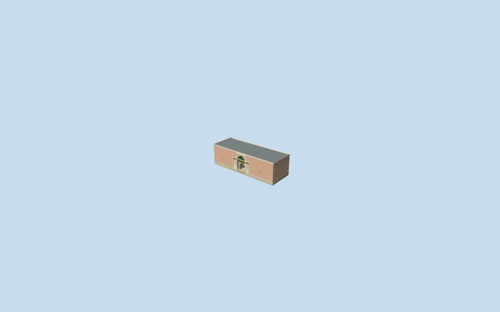
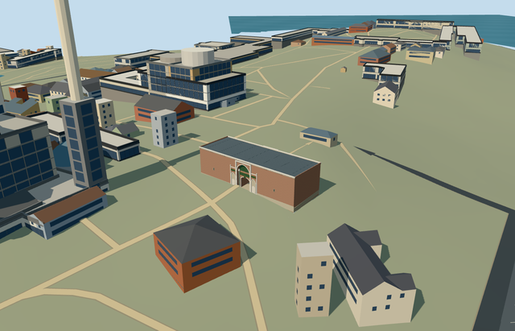

# imperial_gate_topkapi_palace — Imperial Gate, Topkapi Palace

Reviewed2026-10-21. **Individual member complete to the medium-fi visualization standard. Topkapi Palace remains incomplete:2/18 required members.**

## Appearance

Inspected all48 current source/shared/medium-fi/native views during one continuous author/build/inspect/fix pass. Broad low brick gatehouse, pale marble pointed portal recesses and blind niches on both elevations, four grey-green stone shafts with stepped capitals, genuinely open lower vaulted route and solid enclosure above. Opaque dark-green upper panels/fan and framed medallions use original neutral gold geometry. Low lead cap, fine coping/dentils, narrow wing slits and occupied inclined paving retained. No removed upper storey, Salutation towers/canopy, independent Sultan Ahmed III fountain, copied inscriptions/tughra or furnished guard rooms. The flat library stages judge appearance; the separate original PMTiles scene judges native placement.

## Shared surfaces and browser budgets

Seven existing shared256px graphs: brick, stone_marble, stone_limestone_raw, metal_standing_seam, metal_painted, metal_bronze_cast and stone_granite. Nine surface roles merge into seven textured draws/one skyline draw. No new graph/private atlas/embedded images. Each requested graph read once. Muted brick, pale marble, dark lead, green painted panels and grey-green granite share the existing texture library. Separate POSITION/NORMAL streams and equal CPU/GPU accounting.

| Level | Triangles | Bytes | Draws |
| --- | ---: | ---: | ---: |
| skyline | 796 | 76108 | 1 |
| district | 2770 | 267272 | 7 |
| street | 4810 | 457864 | 7 |
| closeup | 6322 | 600044 | 7 |

Four authored levels796/2770/4810/6322triangles; initial skyline plus district343380bytes. Skyline preserves the low brick silhouette, open passage and occupied floor with simplified portal detail. District adds pointed portal/column/niche profiles; street adds frames and coping detail; closeup refines arches/capitals/dentils/lead seams. Geometry/download/draw/layout budgets pass. Physical ordinary-laptop/phone/tablet/dense-city timings remain pending.

## Native placement

Independent Q21097852/Bab-i Humayun and OSM way335364925, the named Imperial Gate in standard20261020 PMTiles. Its approximately41.1x14.8m four-corner parent lies at the city/First Courtyard entrance, distinct from Gate of Salutation and the separately mapped Sultan Ahmed III fountain. Internal+X follows the front wall southeast; internal+Z faces the city southwest, while internal-Z faces the First Courtyard northeast. World heading0/native east-south. Exact member anchor comes from native footprint bounds. Both ordinary exterior pictures were actually inspected; their gate front/back portal profiles inform the reconstruction. Original standard PMTiles/Mapzen terrain retained. Existing front path control internal[0,18] supplies nativeY0; rear control[0,-18] supplies only a modest slope for occupied paving and the vaulted passage ceiling. Walls remain vertical and roof/coping level; foundations reach original boundary minima. Ground opening stays tightly inside the occupied parent, while the route through the gate remains open. No precinct slab, neighbouring fountain geometry or terrain flattening. Original native terrain, footprint ownership, facing and open-route fit were visually inspected2026-10-21. Approximate exterior placement is accepted; exact thresholds and host terrain accuracy remain outside scope. Only Imperial Gate OSM way335364925/native parent35184707453757 replaced. All777 independent resident records of778 and1557 wider records of1558 retained. Two actual overlapping PMTiles cases at14/15 pass;13 was scanned and has no overlapping source building. Original161x161/6m samples, paths and2637446.8634741725square metres native water unchanged. Occupied inclined paving seals the bounded parent terrain opening; the true gate passage remains clear. Failure keeps778 originals; all LOD unloads restore terrain/water/zero live model geometry. Native exterior fit accepted at the named parent between city and First Courtyard. Signed internal front-wall axis southeast; internal+Z city southwest and-Z courtyard northeast. Approximate facade-bearing uncertainty10degrees; exact historical thresholds, optical properties, height datum and accessible routes are not certified. The shared placement view uses a flat control fixture; native evidence is the separate original PMTiles scene.

## Scope and limits

Two ordinary exterior pictures actually viewed: city-facing front2024 and First Courtyard detail2018. Standard PMTiles supplies the particular named four-corner gate footprint, paths and independent fountain context. The native parent has no qualified architectural height. Picture-led working wall10.7m/coping11.15m, open lower passage4.15m above its inclined floor with clear width3.8m, tall pointed recesses to about9m plus local grade, marble jambs to about9.7m plus grade. Working frontispiece/niche/panel/column proportions, dentil counts and low inaccessible roof cap remain approximate visualization geometry, not surveyed dimensions or present-condition/engineering/access certification. The current low single-volume profile is modelled; no removed upper storey is reconstructed. Fine wall and ceiling art is excluded. Fine inscriptions and tughra are replaced by neutral original geometric bands/panels. Topkapi Palace is an18-member collection; completion of this gate does not complete the palace.

## Selected checks

Six Khronos files: zero errors/warnings.156 actual mesh/contact probes;48 inspected frames;2 actual overlapping native map-level cases14/15 (13 scanned without an overlapping building). Selected source/import/placement/strict medium-fi/scene/sim30/lint checks pass.Sim30 sha256:2294c141613c0a20ba69e92b9745ea5dee29753492b470276abc7a93875ce976.

Source sha256:7a56eaa1398cf42a46442536dbe45b6834596d9b3ed15429dd25f56c414c1c09

Runtime sha256:0ac29d303f82f04c2c8450f8cbd53f58ad967daa02ac4a6b634eaab32c91ebce

Input sha256:e5ecd840eac8634c6a2f3c82871f3243bfc10845705f5b617a69e67cfc0800de

Rebuild: node packages/worldgen/scripts/generate-additional-landmarks.mjs --ids=imperial_gate_topkapi_palace; node packages/worldgen/scripts/import-structure-models.mjs --ids=imperial_gate_topkapi_palace; node packages/tooling/scripts/generate-landmark-lods.mjs --ids=imperial_gate_topkapi_palace --force.

## Ordinary picture references

https://commons.wikimedia.org/wiki/File:Imperial_Gate_Topkapi_Istanbul_(2024).jpg — Premeditated; 2024-09-22; CC-BY-SA-4.0. Viewed only; no copied pixels.

https://commons.wikimedia.org/wiki/File:Topkap%C4%B1_Imperial_Gate_First_Courtyard_side_2018_06_6314.jpg — Dosseman; 2018-06-07; CC-BY-SA-4.0. Viewed only; no copied pixels.
