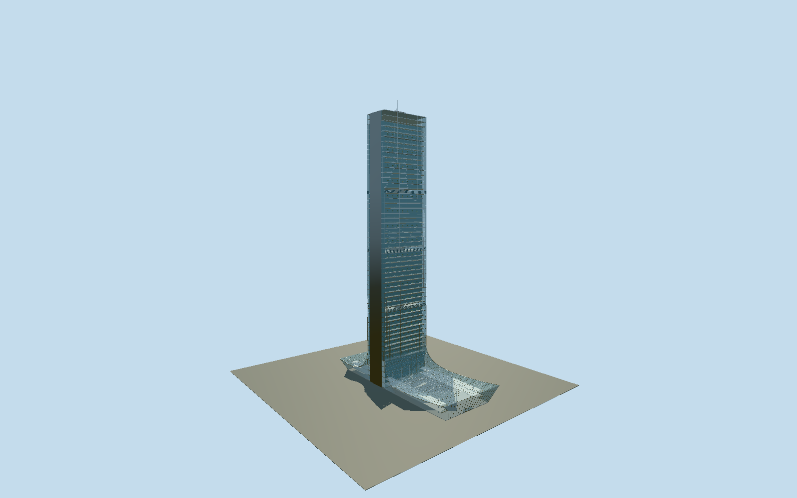

# Istanbul Sapphire

Slightly tapered double-shell tower with recessed three-storey garden cavities and wood balcony edges, opaque south end blade, longer east curved/upturned retail canopy, two observation floors and slender rooftop mast.

## Evidence and reconstruction

Published dimensions and reconstructed details are separated in spec.json. Primary references:

- [Reference](https://www.tabanlioglu.com/project/sapphire/)
- [Reference](https://www.tabanlioglu.com/au-march-2013-2/)
- [Reference](https://www.tabanlioglu.com/larchitetto-april-2011/)
- [Reference](https://www.skyscrapercenter.com/building/torre-costanera/748)
- [Reference](https://www.openstreetmap.org/way/673790538)

No third-party geometry, photograph or bitmap texture is embedded. Shared surface graphs come from the central library; vertex tints carry model colors. Glazing uses PBR materials; transparent surfaces are declared per model.

## Model and axes

62,596 triangles; 175,706 vertices; 6 material groups; 7,080,076 bytes. Native bounds: -31.102, 0.000, -93.584 to 31.102, 261.000, 51.385. Source hash: `sha256:d6c40b73501e57c3e86a03ca5fed61e7075487fdfe77e14fe025395e467f2269`.

{"up":"+Y","longitudinal":"+X along the mapped tower axis, approximately south","front":"-Z east, signed by independent exact-QID mall ring","origin":"Cached tower part center at provisional pavement contact"}

The geographic proposal uses exact-QID OpenStreetMap evidence. Map-derived orientation and estimated architectural details require real-site visual review; preview eligibility is distinct from geographic/fidelity approval. Map attribution: © OpenStreetMap contributors, ODbL-1.0.

## Reproduce

Run `node packages/worldgen/scripts/generate-signature-towers.mjs --ids=istanbul_sapphire` (or add `--check`). The generator preserves manually edited masters by checking their baseline hashes. Import through the standard authored-model workflow with optimization disabled; then capture all QA cameras, including shared-surface views.

## Pending work

- Original 21-part/35-placement istanbulSapphireStudy.encodeAssembly remains unchanged and reconstitutes the 79531556-byte source master (1547192 expanded /947096 stored triangles). Reviewed source and browser closeup reconstruct the same double-shell tower at medium-fi with all sixteen three-storey garden groups, two balcony slabs, transparent weather shell, recessed inner glazing, wood gallery edges, faceted planted beds, three social louvre groups, opaque south blade, two observation floors and 261 m mast. Galleries and plants now taper together with the outer skin, preventing protrusion from the old untapered repeated interiors. Continuous shared grids replace independent per-pane seal/frame boxes; wood grain replaces dense edge battens; faceted crowns replace tens of thousands of individual leaves. Explicit glass skins and interior volumes remain in close/street; district/skyline use opaque surfaces and omit interior garden geometry. Street reduces 30 long-face bays to six, 12 end bays to three, uses a broad inner pane, omits rail posts and plant trunks, and reduces beds/canopy ribs. Close retains the long-face two-light rhythm, single-light end glazing, seven-bay inner glazing, coarse handrail posts and faceted foliage. Detailed source master remains available from its original recipe, not installed by the viewer. Retail footprint corrected to fresh exact-QID mall ring, independent from preserved tower rectangle; glass roof overhang and curve endpoints/width are approximate. Eight east entrance leaves are an illustrative existing reconstruction, not a verified count; interiors have generic slabs/cores/galleries, no claimed apartment or retail fitout. 55 registry floors, 64 mapped levels and 48 residential plus lower/observation facade rows are separate; working 24.3/230.7/239.35/242.2 m levels, .8/.65 m taper, 4.3 m intervals, plant distribution and 62 m roof width are photographic/section reconstructions, not dimensioned surveys. Three canonical graphs provide concrete, stainless and wood; opaque/42 percent clear glass and foliage yield six near groups with one BLEND group and no embedded images. Underground car parks, neighboring towers, metro and wider site excluded. Physical phone/laptop and dense-city timings remain pending.

This bundle follows the medium-fi standard. Medium-fi appearance and geographic fit are reviewed separately. Hash-bound visual acceptance is recorded separately after capture inspection.
