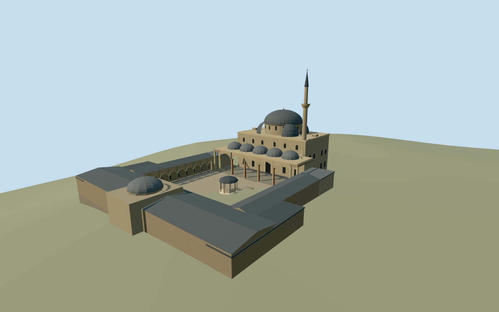

# Kara Ahmed Pasha Mosque

Ottoman cut-stone mosque and open madrasa court in Topkapı, with a lead-covered dome, single-balcony minaret, five small porch domes and roofed fountain.

Authoring state: **review-in-qa.json**. Current completion evidence is in [qa.json](qa.json) and the [completion ledger](../../../../qualla-structures/batches/qualla-003.PROGRESS.md).

- [Kara Ahmed Pasha Mosque](https://qualla.com/kara-ahmed-pasha-mosque/)

Core proportions follow Gurlitt’s measured section and the mapped standing complex. The present minaret height, roof seams, gallery details and windows are estimated from documented architecture.

The fountain is a simplified interpretation of the covered courtyard structure. Separate streetside mausoleum, school and monuments are outside the assembled mosque and madrasa enclosure.

Ornamental stone, lead flashing, porch tiles and interior details are simplified.

Build: `node content/worldgen/source/places/sx/sxk/kara_ahmed_pasha_mosque/models/generate-kara-ahmed-pasha-mosque.mjs`. Add `--check` to verify exact regeneration. 12860 triangles; 6 materials; no embedded photographs.
