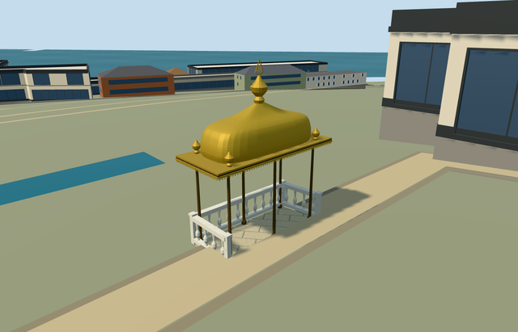

# kiosk_for_breaking_fast_topkapi_palace - Kiosk for Breaking Fast, Topkapi Palace

Reviewed 2026-10-21. **Complete as a medium-fi canopy with approximate native terrace fit. Topkapi remains incomplete:16/18ready. Hasoda and Sofa Mosque native terrain fits remain pending.**

## Built and inspected

Specific open six-post dark-metal canopy with two garden entry bays, low pale stone platform and three short baluster guards. Broad gilded eaves, curved rectangular bell/cushion roof, four small corner bulbs and central spindle/open geometric crest; thin open eave fringe and dark plain soffit. Two ordinary canopy/roof photos plus existing PMTiles informed a continuous author/build/inspect/fix pass. Smoothed the visible roof banding by using continuous cubic profile slopes. Calligraphic crest is represented only by a simplified open geometric shape; no copied inscription/art. Independent long precinct balustrade, Baghdad Kiosk and pool remain context.

## Shared textures and browser LODs

Six existing256px shared graphs across seven roles: limestone floor, marble rails, ashlar footing, bronze shared by gilded roof/finials, painted-metal dark posts and plain wood soffit. Linear gold/bronze/brown/stone tints and metric floor/footing/roof quad UVs. No new graph/private atlas/embedded images. Separate POSITION/NORMAL streams, CPU/GPU accounting agrees. Seven near draws/one skyline draw; native fixture requests each graph once and disposes model geometry on unload. The shared weathered bronze graph approximates polished gilded metal sheen.

| Level | Triangles | Bytes | Draws |
| --- | ---: | ---: | ---: |
| skyline | 656 | 69,164 | 1 |
| district | 3,022 | 310,680 | 7 |
| street | 6,862 | 685,524 | 7 |
| closeup | 15,310 | 1,512,760 | 7 |

Initial geometry: **379,844 bytes**. Four authored LODs656/3022/6862/15310triangles. Initial skyline+district geometry379844bytes. Skyline keeps the six-post/gilded-roof silhouette with solid guards; district restores the balusters; street/close-up add open eave fringe, finer curved roof and simplified crest. Small detail densities decrease by distance. Synthetic fixture is not evidence of geographic terrain fit. Physical ordinary-laptop, phone/tablet and dense-city timing measurements remain pending.

## Native placement

Named site Q170495/way1272157518/native35185644246350, exact four-corner independent layer1 canopy and signed northeast long axis/southeast garden entry/city-view edge. One actual overlapping detailed PMTiles15case passes; no overlapping13/14feature present. Only its parent native building removed after model load; all258 independent resident records of259/all572wider records of573 retained. Original161x161/6m terrain, roads and3400906.0006393427square metres water unchanged. Ground opening is only occupied platform and is sealed by model flooring. Uncovered provider internal[0,3] is outside all573 original records; original terrain remains there and around the platform. Native modelWorldY approximately0. Boundary grade varies0.22943654821224157m; low platform/feet/facing inspected and approximate terrace fit accepted. Failed load retains259 originals; every unload restores ground/water and zero live geometries. All seventeen previous palace assets retain source/runtime/input pins; Hasoda and Sofa Mosque remain inactive terrain-fit drafts.

## Fidelity and limitations

Pictured six-post open canopy, gilded curved rectangular roof, broad eaves, corner bulbs/main spindle, pale short rails and low platform guide the particular asset.2.5m eaves,1.05-1.2m curved roof rise,0.85m spindle/crest, fine hidden soffit/rail inventory and roof curve are picture-led approximations. Simplified crest omits exact calligraphy; shared bronze texture approximates gilded sheen. Exact historical terrace elevation/threshold/accessibility remains unverified on original coarse terrain. No custom terrain/precinct flattening, copied artwork or independent long terrace/pool/palace structures. All eighteen Topkapi members now have authored source; only sixteen have approved approximate native placement. Hasoda/Sofa Mosque fit remains unfinished.

## Targeted checks

Six GLBs: zero Khronos errors/warnings;192mesh/contact probes;48current inspected views;one actual overlapping detailed PMTiles15case. No overlapping13/14feature present. Selected source/import/placement/strict medium-fi/scene/sim30/lint pass. Sim30 sha256:7a61f53f64e8e4afbf0bd204b7489c34a3685c0a62f78936f1029f912b53c5dd. Current pins: [qa.json](qa.json). Editable controls: [map-frame.json](map-frame.json).

## Viewed references

- https://commons.wikimedia.org/wiki/File:Iftar_bower_in_the_Fourth_Courtyard_of_the_Topkap%C4%B1_Palace,_Istanbul,_Turkey_001.jpg - Moonik; 2012-07-01; CC-BY-SA-3.0. Viewed only; no copied pixels.

- https://commons.wikimedia.org/wiki/File:Detail_from_the_Iftar_Bower_at_Topkapi_Palace.jpg - Jose Luiz Bernardes Ribeiro; 2011-09-15; CC-BY-SA-3.0. Viewed only; no copied pixels.

- https://www.openstreetmap.org/way/1272157518 - v1, independently mapped pavilion canopy, layer1; OpenStreetMap contributors, ODbL1.0. Site Q170495 retained with this independent way.
