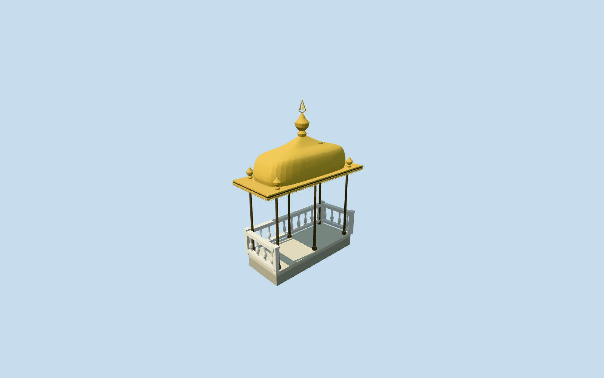

# Kiosk for Breaking Fast, Topkapi Palace

Iftar/Kiosk for Breaking Fast: open six-post dark-metal canopy over a low pale stone platform with three short baluster guards/open garden entry, broad gilded eaves, curved rectangular bell/cushion roof, four small corner finials and tall central spindle with a simplified open crest. Gold beaded/scalloped eave border and dark plain soffit; no copied calligraphic crest/art or independent Baghdad/pool/precinct balustrade.

## Evidence and reconstruction

Published dimensions and reconstructed details are separated in spec.json. Primary references:

- [Reference](https://commons.wikimedia.org/wiki/File:Iftar_bower_in_the_Fourth_Courtyard_of_the_Topkap%C4%B1_Palace,_Istanbul,_Turkey_001.jpg)
- [Reference](https://commons.wikimedia.org/wiki/File:Detail_from_the_Iftar_Bower_at_Topkapi_Palace.jpg)

Iftar/Kiosk for Breaking Fast: open six-post dark-metal canopy over a low pale stone platform with three short baluster guards/open garden entry, broad gilded eaves, curved rectangular bell/cushion roof, four small corner finials and tall central spindle with a simplified open crest. Gold beaded/scalloped eave border and dark plain soffit; no copied calligraphic crest/art or independent Baghdad/pool/precinct balustrade.

## Model and axes

15,310 triangles; 43,674 vertices; 7 material groups; 1,760,348 bytes. Native bounds: -1.929, -0.450, -2.155 to 1.929, 4.764, 2.154. Source hash: `sha256:26c833b62a7dddfa2262364f2c35aa432dfd84eedccb1eeade324ea06999ea43`.

{"x":"east","y":"up","z":"south"}

The geographic proposal uses exact-QID OpenStreetMap evidence. Map-derived orientation and estimated architectural details require real-site visual review; preview eligibility is distinct from geographic/fidelity approval. Map attribution: © OpenStreetMap contributors, ODbL-1.0.

## Reproduce

Run `node packages/worldgen/scripts/generate-additional-landmarks.mjs --ids=kiosk_for_breaking_fast_topkapi_palace` (or add `--check`). The generator preserves manually edited masters by checking their baseline hashes. Import through the standard authored-model workflow with optimization disabled; then capture all QA cameras, including shared-surface views.

## Pending work

- Iftar/Kiosk for Breaking Fast: open six-post dark-metal canopy over a low pale stone platform with three short baluster guards/open garden entry, broad gilded eaves, curved rectangular bell/cushion roof, four small corner finials and tall central spindle with a simplified open crest. Gold beaded/scalloped eave border and dark plain soffit; no copied calligraphic crest/art or independent Baghdad/pool/precinct balustrade.
- Named Topkapi site Q170495 member OSM way1272157518 v1/native35185644246350, layer1 independent pavilion canopy. Exact four-corner roof retained. Internal+X northeast follows the long roof; internal+Z southeast faces the garden entry, with the city-view edge at internal-Z. Independent surrounding terrace rails/palace buildings remain native context.
- Picture-led floor-0.0008576538061936256m relative to uncovered provider,2.5m column/eave height,1.05m curved gilded roof rise and0.85m central spindle/crest. Six columns, four small roof finials and three baluster guards follow visible composition; fine bell profile, hidden soffit/rail inventory and exact crest are reconstructions. No reproduced calligraphy.
- Original standard Protomaps20261020/Mapzen extract and161x161/6m terrain retained. Provider internal[0,3] is outside all573 native building records. Low platform top0.14m above highest canopy boundary; protective footing down to lowest boundary. Only occupied platform ground cut and sealed by floor; original surroundings retained. Historical terrace grade/accessibility unverified; no bespoke terrain or precinct flattening.

This bundle follows the medium-fi standard. Medium-fi appearance and geographic fit are reviewed separately. Hash-bound visual acceptance is recorded separately after capture inspection.
