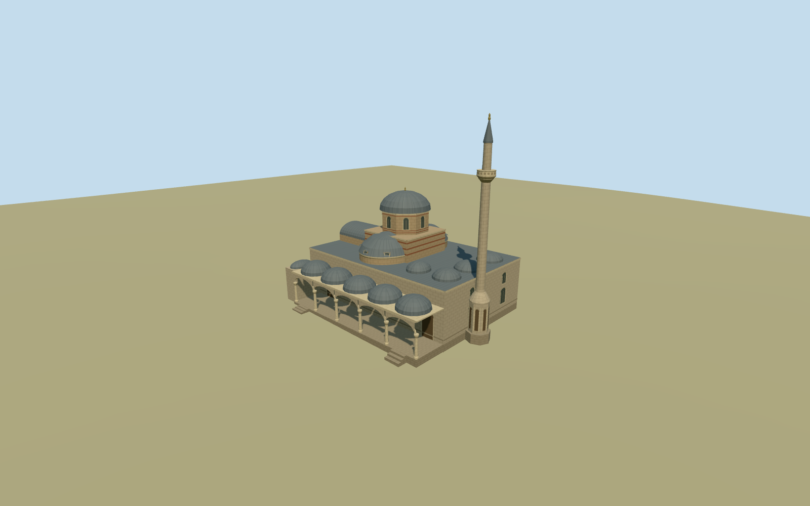

# Koca Mustafa Pasha Mosque

Koca Mustafa Pasha Mosque with a short five-domed portico, central octagonal drum, paired semidomes, eastern chancel roof and a single slender western minaret.

Authoring state: **review-in-qa.json**. Current completion evidence is in [qa.json](qa.json) and the [completion ledger](../../../../qualla-structures/batches/qualla-003.PROGRESS.md).

- [Koca Mustafa Pasha Mosque](https://qualla.com/koca-mustafa-pasha-mosque/)

The measured historic plan locates the surviving converted church. The current heritage register supplies the five courtyard bays following restoration. Fine window spacing, dome and minaret elevations, and the external masonry colors are estimated.

The original local elevation is a regional raster and constrains the approach and grade. The recorded historic finishes are simplified in the shared viewer. Interiors and separately mapped tombs, fountains and schools are outside the mosque exterior scope.

Build: `node content/worldgen/source/places/sx/sxk/koca_mustafa_pasha_mosque/models/generate-koca-mustafa-pasha-mosque.mjs`. Add `--check` to verify exact regeneration. 7290 triangles; 7 materials; no embedded photographs.
