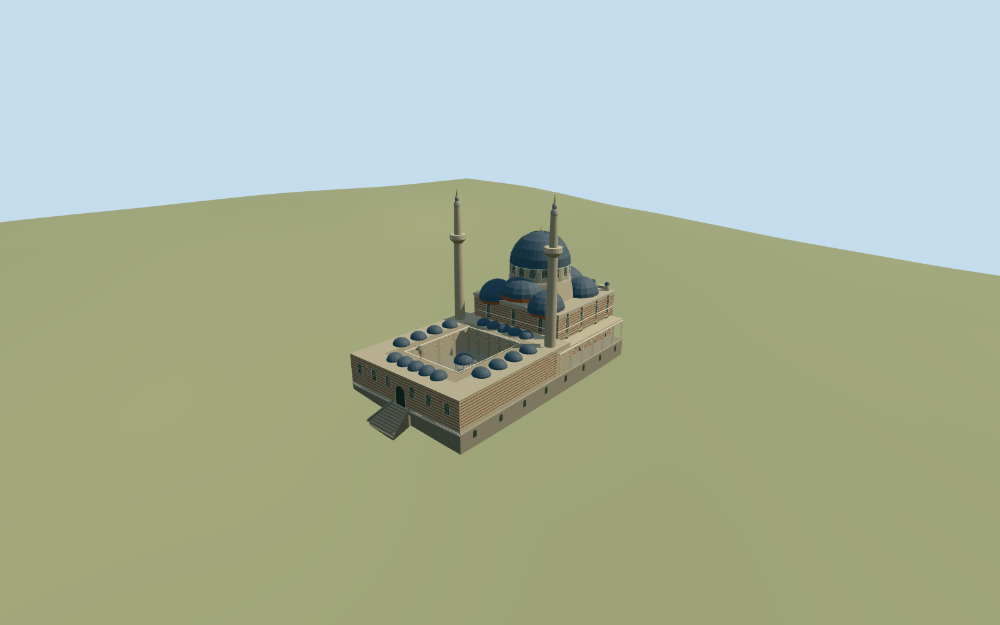

# Laleli Mosque

Laleli Mosque with striped masonry, elevated prayer hall, open domed court, two minarets and the tall lead dome.

Authoring state: **review-in-qa.json**. Current completion evidence is in [qa.json](qa.json) and the [completion ledger](../../../../qualla-structures/batches/qualla-003.PROGRESS.md).

- [Laleli Mosque](https://qualla.com/laleli-mosque/)

Dome diameter and interior height follow the published 12.50 m and 24.50 m dimensions. Exterior roof thickness, the mosque-floor elevation above the site, the six roof volumes and both minaret heights are estimated.

The model shows the named mosque and its courtyard, stairs, outer galleries and raised masonry base. Subterranean rooms, the adjoining buildings and the separately mapped sultans’ mausoleum are outside the scope.

The outer and courtyard outlines follow the native map. Smaller wall projections, column counts in partially visible bays, masonry bands and glazing lattices are simplified.

Build: `node content/worldgen/source/places/sx/sxk/laleli_mosque/models/generate-laleli-mosque.mjs`. Add `--check` to verify exact regeneration. 18890 triangles; 6 materials; no embedded photographs.
